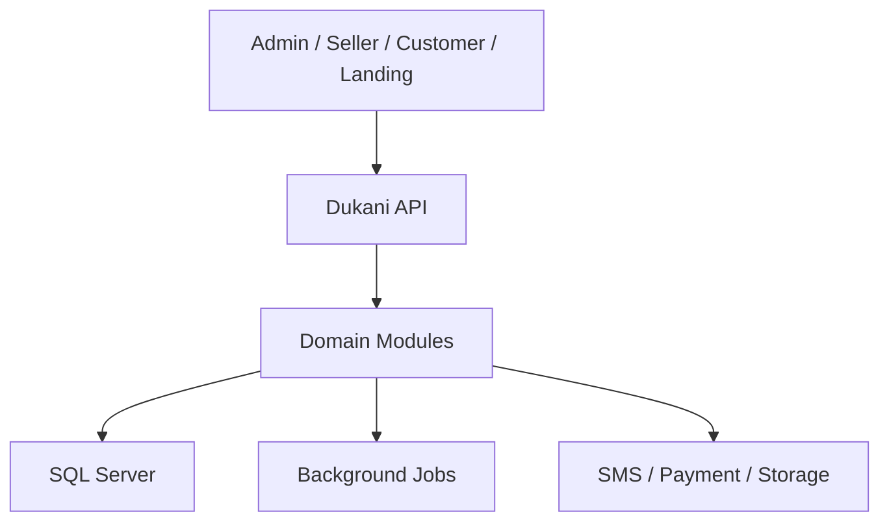

# معماری بک‌اند — وضعیت و اثرهای محصول

## اعتبارسنجی موبایل و ورودی عددی — بازنگری 2.4.1، 2026-09-26

ورود همچنان فقط با موبایل و OTP است؛ شاهکار و کد ملی به آن اضافه نمی‌شود. قواعد این بخش برای فرم‌های ورود فروشنده و مشتری در موبایل/دسکتاپ یکسان است.

| ورودی | قرارداد قطعی |
|---|---|
| موبایل ایران | مقدار نهایی رشته‌ای ۱۱ رقمی، با شروع `09`؛ پس از نرمال‌سازی ارقام، الگوی `^09[0-9]{9}$` |
| OTP | رشته دقیقاً ۶ رقمی با الگوی `^[0-9]{6}$`؛ صفر ابتدای `012345` حفظ شود |
| عدد صحیح | فقط رقم؛ min/max و مثبت‌بودن بسته به فیلد؛ موبایل و OTP به Number تبدیل نشوند |
| مقدار اعشاری / پول | قرارداد مستقل Decimal/Money؛ قانون عدد صحیح نباید فروش کیلویی و مقدار کسری را از کار بیندازد |

اعداد فارسی `۰۱۲۳۴۵۶۷۸۹` و عربی `٠١٢٣٤٥٦٧٨٩` به `0123456789` نرمال شوند. تایپ، Paste، autofill و ورودی موبایل همه از همان تابع کنترل عبور کنند؛ محدودسازی keydown به‌تنهایی کافی نیست. حروف، علامت منفی/مثبت، اعشار، نماد علمی مانند `1e5` و متن مختلط به‌عنوان عدد پذیرفته نشوند؛ حروف را حذف نکنید تا یک ورودی غلط به شماره یا کد دیگری تبدیل شود. انتخاب متن، پاک‌کردن، کلیدهای حرکت، Tab و میانبرهای Paste مجازند.

در فیلد موبایل، Paste یک شماره کامل با پیش‌شماره ایران `+98` یا `0098` و فاصله/خط تیره متعارف، قبل از اعتبارسنجی به فرم `09…` تبدیل شود؛ سایر کدهای کشور رد شوند. مقدار UI و payload این فلو در قالب محلی `09…` و با ارقام ASCII به API می‌رود. ورودی بلند بی‌صدا کوتاه نشود. در OTP فقط trim فضای ابتدا/انتها مجاز است؛ متن مخلوط، جداکننده داخلی و بیشتر از ۶ رقم رد شوند. SMS autofill کد استخراج‌شده را تحویل همین validator بدهد.

### زمان و اثر خطا

- فرم دست‌نخورده خطای قرمز ندارد. از اولین تغییر، اعتبارسنجی فرانت در همان رویداد input/change انجام شود؛ منتظر submit، blur یا پاسخ سرور نماند. شماره یا کد ناقصِ ویرایش‌شده هم نامعتبر است.
- هنگام اصلاح به مقدار معتبر، خطای قالب فوراً پاک شود. دکمه «دریافت کد ورود» فقط با موبایل معتبر و دکمه «تأیید و ورود» فقط با کد ۶ رقمی معتبر فعال شود. اعتبار قالب OTP به معنی درست‌بودن کد نیست؛ تطبیق کد و انقضا در سرور است.
- مقدار نامعتبر هیچ درخواست ارسال/تأیید OTP نسازد. خطای قالب از شکست سرویس پیامک یا کد نادرست سرور تفکیک شود. تلاش برای درج کاراکتر غیرعددی رد و پیام «فقط رقم وارد کنید» نمایش داده شود؛ مقدار پذیرفته‌شده قبلی حفظ شود و با ویرایش معتبر بعدی خطا پاک گردد.
- سرور همین قالب را مستقل دوباره اعتبارسنجی کند؛ فرانت جایگزین اعتبارسنجی API و محدودیت تلاش نیست.

### متن و ظاهر خطا

| حالت | پیام |
|---|---|
| موبایل خالی بعد از ویرایش | شماره موبایل را وارد کنید. |
| موبایل با طول/پیش‌شماره غلط | شماره موبایل باید ۱۱ رقم باشد و با ۰۹ شروع شود. |
| کاراکتر غیرعددی | فقط رقم وارد کنید. |
| OTP ناقص | کد ورود باید دقیقاً ۶ رقم باشد. |
| OTP صحیح از نظر قالب ولی ردشده سرور | کد واردشده درست نیست. دوباره تلاش کنید. |

خطای فیلد: حاشیه قرمز و متن Danger در کنار همان فیلد. خطای فرم/سرویس: `Alert / Type=Danger` با زمینه قرمز روشن، متن/حاشیه قرمز و آیکون هشدار. استفاده از رنگ سبز، Success یا رنگ برند برای قاب خطای اعتبارسنجی ممنوع است؛ رنگ برند روی دکمه «اصلاح» مجاز و معنای موفقیت ندارد. رنگ به‌تنهایی پیام خطا نیست. در فرانت `aria-invalid` و ارتباط خطا با `aria-describedby` و اعلان مناسب خوانشگر لحاظ شود؛ از اعلان مکرر و آزاردهنده هر رقم جلوگیری شود.

API شماره و OTP را رشته می‌گیرد؛ اعتبارسنجی مستقل با regexهای بالا پس از نرمال‌سازی انجام شود. از `\d` عمومی Unicode به‌جای `[0-9]` برای payload نرمال‌شده استفاده نشود. OTP خام در log ثبت نشود. خطای قالب 400/422 طبق قرارداد API و خطای تطبیق کد با errorCode مستقل برگردد.

---


## فناوری بک‌اند و پیشنهاد دیتابیس

- **تصمیم کاربر:** ASP.NET Core / C# (.NET).
- **پیشنهاد این بازنگری:** PostgreSQL + EF Core + Npgsql؛ انتخاب نهایی دیتابیس هنوز نیازمند تصمیم تیم است و مهاجرتی انجام نشده است. SQL Server در متن تاریخی زیر، انتخاب جاری تأییدشده محسوب نمی‌شود.
- دلیل پیشنهاد: داده‌های فروش، موجودی، پرداخت و بدهی رابطه‌ای‌اند؛ تراکنش، قیدهای یکتا و کلید خارجی و کنترل همزمانی لازم‌اند. Npgsql ارائه‌دهنده EF Core برای PostgreSQL است. JSONB فقط برای ویژگی‌های متغیر کاتالوگ مناسب است؛ مبلغ، تعداد، مشتری و اسناد مالی ستون‌ها/جدول‌های صریح دارند.
- SQL Server نیز برای .NET مناسب است؛ اگر تجربه عملیاتی و زیرساخت آماده SQL Server دارید، انتخاب آن منطقی است. صرف استفاده از .NET دلیل الزام SQL Server نیست.
- MVP یک Modular Monolith با Worker است؛ Redis و سرویس‌های مجزا پیش‌نیاز نیستند. نسخه‌های پشتیبانی‌شده .NET، EF Core و Npgsql با سازگاری بررسی‌شده انتخاب شوند.

### مدل حداقلی ورود

| موجودیت | داده و قاعده |
|---|---|
| users | شناسه پایدار، mobile_normalized یکتا، phone_verified_at، status؛ بدون رمز و بدون کد ملی برای ورود |
| otp_challenges | شناسه تصادفی، شماره، purpose، HMAC کد با کلید سرور، expires_at، resend_at، attempts، consumed_at، وضعیت ارسال؛ کد خام ذخیره نشود |
| auth_sessions | user_id، ایجاد/انقضا/لغو، شناسه یا هش secret نشست، اطلاعات محدود دستگاه؛ خروج در سرور اعمال شود |
| store_memberships | user_id، store_id، role و status؛ موفقیت OTP مجوز فروشگاه ایجاد نمی‌کند |
| store_customers | رکورد محلی فروشنده مستقل از users؛ اتصال اسناد تاریخی صرفاً با برابری شماره انجام نشود |

SMS از طریق رابط IOtpSender و تنظیمات سرور؛ هیچ ShahkarClient یا identity_verifications مربوط به شاهکار برای این نیاز لازم نیست. Secret سرویس پیامکی فقط در سرور نگهداری شود. نشست وب با Cookie امن HttpOnly و کنترل CSRF؛ پاسخ ورود وجود حساب را پیش از OTP افشا نکند. درخواست/تأیید/ارسال مجدد نرخ‌محدود و تغییر شماره نیازمند نشست فعلی معتبر و OTP شماره جدید است؛ تعارض شماره به ادغام خودکار منجر نشود.

### قرارداد داده برای انتخاب PostgreSQL

مبالغ decimal در .NET و numeric در DB؛ تعداد و ضریب بسته با دقت مشخص و بدون float؛ مبنای پول و گردکردن در قرارداد واحد. شماره و بارکد رشته‌اند. موجودی از گردش‌ها قابل بازسازی و قطعی‌کردن فروش، گردش موجودی، دریافت و مانده در یک تراکنش واحد است؛ مرز ماژول مانع تراکنش هماهنگ فروش نمی‌شود. دسترسی‌ها store-scoped و عملیات ثبت دارای کلید idempotency هستند. آزمایش یکپارچه روی خود دیتابیس انتخابی اجرا شود.

منابع فنی: [Npgsql EF Core](https://www.npgsql.org/efcore/)، [EF Core providers](https://learn.microsoft.com/en-us/ef/core/providers/)، [PostgreSQL numeric](https://www.postgresql.org/docs/current/datatype-numeric.html).

## تصمیم جاری ورود — بازنگری 2.4.0، 2026-09-26

طبق آخرین اصلاح مالک محصول، ورود فقط با **شماره موبایل و کد یک‌بارمصرف پیامکی** است. درخواست پیشین درباره شاهکار لغو شد: در ورود هیچ کد ملی، استعلام شاهکار یا حالت عدم تطابق مالکیت شماره وجود ندارد. کد ملی اختیاری در اطلاعات مالک فروشگاه، اگر در پروفایل حفظ شده باشد، شرط ورود نیست.

OTP فقط دسترسی به شماره را تأیید می‌کند؛ اثبات مالکیت قانونی سیم‌کارت، اعتبار مالی یا مالکیت اسناد قدیمی نیست. ثبت مشتری توسط فروشنده بدون ورود مشتری و بدون OTP باقی می‌ماند. پنل مشتری در نسخه 1.2 از همین قرارداد استفاده می‌کند؛ زمان انتشار آن به MVP منتقل نمی‌شود.

1. کاربر شماره موبایل را وارد می‌کند؛ ارقام فارسی/عربی/لاتین نرمال و قالب شماره کنترل می‌شود.
2. سرور یک چالش ورود ایجاد و کد را از سرویس پیامکی ارسال می‌کند. پاسخ شامل شناسه چالش، زمان انقضا و زمان مجاز ارسال مجدد است؛ کد در پاسخ API نیست.
3. کاربر کد را وارد می‌کند. کد درست و منقضی‌نشده، فقط یک بار و به‌صورت اتمیک مصرف می‌شود.
4. حساب موجود بازیابی می‌شود؛ در نخستین ورود حساب بدون رمز ساخته می‌شود. ایجاد حساب هیچ نقش ادمین یا دسترسی خودکار به فروشگاه دیگر نمی‌دهد.
5. نشست صادر و مقصد مجاز قبلی بازیابی می‌شود؛ فروشنده به انتخاب/ایجاد فروشگاه و مشتری به حساب خود می‌رود.

کد نادرست: اصلاح همان ورودی؛ کد منقضی: درخواست کد تازه؛ محدودیت تلاش/ارسال: انتظار طبق زمان سرور؛ شکست ارسال پیامک: تلاش مجدد بدون ایجاد نشست. تغییر شماره چالش قبلی را باطل می‌کند. ارسال مجدد کد قبلی را باطل می‌کند. دوبار کلیک یا دو درخواست همزمان نباید دو نشست یا دو حساب ناخواسته بسازد. وضعیت نامعلوم ارسال با همان شناسه پیگیری می‌شود.

پیش‌فرض اجرایی پیشنهادی، قابل تنظیم در سرور: کد 6 رقمی، اعتبار 120 ثانیه، ارسال مجدد پس از 60 ثانیه، حداکثر 5 تلاش برای هر چالش؛ محدودیت تجمیعی شماره و IP مستقل است. شمارنده UI از سرور می‌آید؛ زمان‌های فیگما صرفاً نمونه‌اند. کد، کد ملی یا توکن در لاگ و analytics ثبت نمی‌شود. فقط پس از موفقیت OTP دسترسی تجاری صادر می‌شود.

---


> بازنگری اسناد: 2.1.0 — 2026-09-24. شمارهٔ سند با شمارهٔ انتشار محصول متفاوت است. مبنا: ZIP اصلی، بازبینی‌های قبلی و تصمیم‌های اخیر مالک محصول. این بسته مشخصات پیشنهادی تکمیل‌شده برای بازبینی است؛ ادعای تغییر یا تأیید فیگما ندارد.

## وضعیت

طبق دستور مالک، بازطراحی معماری در این تحویل انجام نشده است. سند کامل قبلی در بخش مرجع حفظ شده؛ موارد محصولی جدید برای بازبینی بعدی آمده‌اند. قرارداد نسخه‌های محصول و واژگان جاری بر ارجاع‌های تاریخی مقدم است.

## اثرهای محصول برای بازبینی بعدی معماری

این بخش نیازمندی است، نه انتخاب تازه فناوری یا بازطراحی کدبیس:

- هویت کاتالوگ از کالای فروشگاه و موجودی جدا؛ واحد پایه و ضریب تاریخی هر ردیف.
- Catalog approval و override محلی مستقل؛ بارکد دارای scope و واحد؛ snapshot اسناد.
- رسید و فروش چندقلمی، پیش‌نویس و شناسه عملیات؛ کنترل اتمیک موجودی/فاکتور/دریافت/بدهی.
- دریافت و تخصیص به چند سند از ابتدا تفکیک مفهومی دارند؛ مشتری فروشگاهی با هویت تأییدشده و عضویت باشگاه یکی نیست.
- تاریخ رخداد، تاریخ ثبت، actor و علت اصلاح؛ وضعیت بهای معلوم/تخمینی/نامعلوم؛ نسخه گزارش و بازسازی وابستگی بها.
- داده تولید/انقضا/قیمت تولیدکننده/چاپی در ردیف ورود، نه محصول عمومی.
- SMS بعد از commit و قابل retry مستقل؛ ارسال/تحویل/ناموفق سه وضعیت متمایز.
- آینده: سفارش با نسخه، رزرو، دریافت بیعانه، تحویل؛ هزینه با تاریخ تعلق و پرداخت؛ چک با رویداد؛ سند حسابداری با مرجع و دوره.
- UI فروش جست‌وجو و سبد همزمان؛ ایجاد درجا و بازگشت به context؛ منوی موجودی مستقل؛ فیلتر گزارش پایدار.
- کنترل دسترسی فروشگاه در API، خروج امن، جداسازی cache، فایل خصوصی فیش/فاکتور و عدم افشای اطلاعات میان فروشگاه‌ها.

پیش از پیاده‌سازی، ADRهای فناوری، تعداد اپ‌ها، قرارداد پول، migration، نگاشت حساب و sync مرور می‌شوند. متن زیر وضعیت تاریخی معماری است و «پذیرفته‌شده» داخل آن به تاریخ همان متن برمی‌گردد؛ در این بازنگری دوباره تأیید نشده است. دامنه نسخه از roadmap جاری گرفته می‌شود.


## متن مرجع معماری قبلی — نیازمند بازبینی، غیرحاکم بر دامنه انتشار

# معماری بک‌اند دکانی

> نسخه: `1.0.0` — وضعیت: تصمیم مبنا — فناوری: ASP.NET Core / C# / SQL Server

## هدف و سبک معماری

بک‌اند دکانی یک **Modular Monolith** است: استقرار ساده برای تیم و بودجه فعلی، مرزهای دامنه روشن، و آمادگی استخراج سرویس تنها پس از مشاهده نیاز واقعی. Clean Architecture درون هر ماژول اجرا می‌شود و هیچ ماژولی مستقیماً جدول داخلی ماژول دیگر را تغییر نمی‌دهد.



## ماژول‌ها

| ماژول | مسئولیت |
|---|---|
| Identity & Access | حساب، OTP پیامکی، Role، Session، Consent |
| Stores | فروشگاه، شعبه، تنظیمات فروش/تحویل/پرداخت |
| Catalog | کاتالوگ مشترک، دسته، برند، ویژگی، بارکد و پیشنهاد اصلاح |
| Inventory | کالای فروشگاه، موجودی، ورود خرید، رزرو و گردش |
| Sales | فروش حضوری، فاکتور، اقلام، مرجوعی و اصلاح |
| Customers | مشتری فروشگاه، آدرس و ارتباط با هویت شبکه |
| Credit & Debt | نسیه، سررسید، تسویه، سقف و امتیاز اعتباری |
| Orders | سبد، سفارش، رزرو، آماده‌سازی، تحویل/ارسال و تاریخچه وضعیت |
| Payments | نقد، کارت، کارت‌به‌کارت، فیش، تطبیق و Provider |
| Reports | Read Model فروش، سود، هزینه، بدهی و موجودی |
| Notifications | SMS/Push/In-app و Template/Outbox |
| Administration | Moderation، Merge، Seed، Audit و عملیات پشتیبانی |

## ساختار Solution

```text
src/
  Dukani.Api/
  BuildingBlocks/
    Domain/
    Application/
    Infrastructure/
    Contracts/
  Modules/
    Catalog/{Domain,Application,Infrastructure,Contracts}/
    Inventory/{Domain,Application,Infrastructure,Contracts}/
    Sales/{Domain,Application,Infrastructure,Contracts}/
    Orders/{Domain,Application,Infrastructure,Contracts}/
    Credit/{Domain,Application,Infrastructure,Contracts}/
tests/
  Unit/
  Integration/
  Architecture/
  Contract/
```

## قراردادهای قطعی داده

- شناسه عمومی Entityها `BusinessId` پایدار و غیرقابل حدس است؛ کلید داخلی DB می‌تواند جدا باشد.
- زمان در DB به UTC ذخیره و در مرز نمایش به منطقه کاربر تبدیل می‌شود.
- مبلغ با نوع Decimal/Integer توافق‌شده، بدون Float، و همراه Currency/Unit قرارداد می‌شود.
- موجودی فقط از طریق `InventoryMovement` تغییر می‌کند؛ مقدار فعلی Projection قابل بازسازی است.
- قیمت خرید قبلی بازنویسی نمی‌شود؛ `StockReceipt` و Cost layer تاریخچه را نگه می‌دارند.
- فاکتور قطعی Immutable است؛ اصلاح با Return/Adjustment و Audit انجام می‌شود.
- سفارش و پرداخت State machine و تاریخچه Transition دارند.
- حذف رکوردهای ارجاع‌شده با Archive/Merge انجام می‌شود.
- optimistic concurrency برای موجودی، سفارش، فیش و تسویه الزامی است.

## API و دسترسی

Endpointها بر حسب Audience جدا ولی داخل یک API مستقر می‌شوند:

```text
/api/v1/public/*
/api/v1/customer/*
/api/v1/seller/*
/api/v1/admin/*
```

- Authorization در Endpoint و Application layer اعمال می‌شود.
- Seller فقط داده Storeهای مجاز خود را می‌بیند.
- Customer فقط هویت، فاکتور، سفارش و بدهی خود را می‌بیند.
- Admin privilegeهای جزئی و Audit کامل دارد.
- API متن UI برنمی‌گرداند؛ `errorCode` پایدار، `parameters` و `traceId` می‌دهد.
- List APIها pagination، filter و sort server-side دارند.
- عملیات قابل تکرار مانند ثبت پرداخت و سفارش `Idempotency-Key` می‌پذیرند.

## تراکنش و رویداد

- تراکنش ACID داخل مرز یک ماژول است.
- ارتباط قابل اتکا با Provider و Job از Outbox استفاده می‌کند.
- Domain Event داخل Process و Integration Event نسخه‌شده برای مرزها استفاده می‌شود.
- عملیات شبکه‌ای امتیاز اعتباری فقط خلاصه تجمیعی و با Consent معتبر ارائه می‌کند.
- نام فروشگاه دیگر، اقلام و جزئیات فاکتورهای دیگر افشا نمی‌شود.

## اعتبار و تسویه

- امتیاز محاسباتی قابل ویرایش دستی نیست.
- فروشنده می‌تواند یادداشت داخلی، سقف فروشگاه و وضعیت «مورد اعتماد» تعیین کند.
- سیستم در MVP پیشنهاد و هشدار می‌دهد و فروش نسیه را خودکار مسدود نمی‌کند.
- تسویه می‌تواند کامل، جزئی یا چندفاکتوری باشد؛ تخصیص قدیمی‌ترین بدهی‌ها پیشنهاد پیش‌فرض است.
- ثبت مشتری به معنی تأیید پرداخت نیست؛ وضعیت `PendingSellerReview` تا بررسی فروشنده حفظ می‌شود.

## امنیت و عملیات

- Access token کوتاه‌عمر، refresh rotation و revoke؛ Cookie امن برای Web/PWA ترجیح دارد.
- OTP rate limit، lockout، device/session audit و محدودسازی brute force.
- Secret در repository یا image ذخیره نمی‌شود.
- فایل با allowlist، اندازه محدود، malware scan و URL امضاشده مدیریت می‌شود.
- داده حساس در log ماسک می‌شود؛ Audit log append-only است.

## تست و Quality Gate

- Unit برای ruleهای دامنه و state machine.
- Integration با SQL Server واقعی کانتینری.
- Contract/OpenAPI برای Client generation و جلوگیری از drift.
- Architecture test برای dependency ruleها.
- Migration test، idempotency، authorization و concurrency قبل از Release.

## مسیر Scale

ابتدا Vertical scale، index، query tuning، cache محدود و background job. استخراج سرویس فقط وقتی انجام می‌شود که مرز مالکیت تیمی، بار مستقل، یا failure isolation با داده اندازه‌گیری‌شده آن را توجیه کند.
