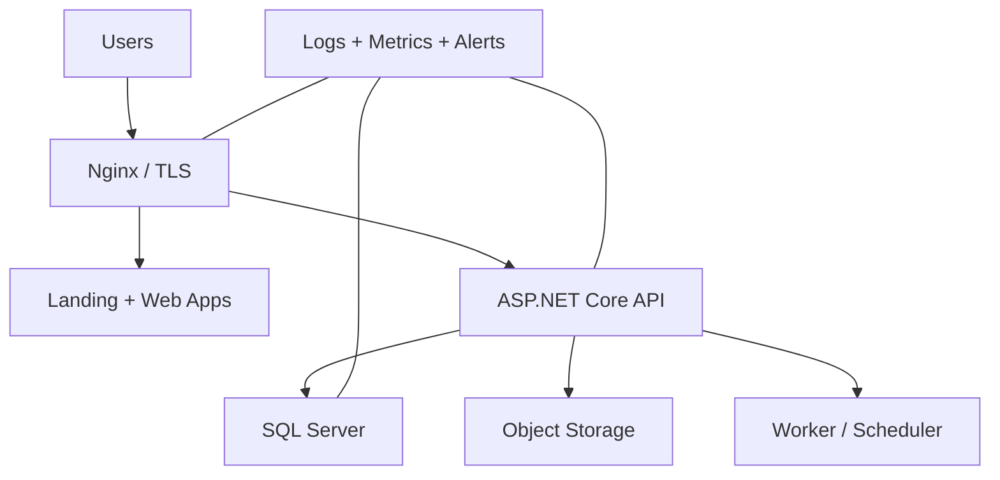
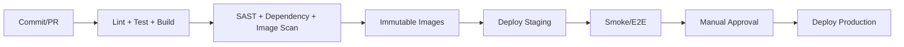

# معماری عملیات — وضعیت و اثرهای محصول

## تصمیم جاری ورود — بازنگری 2.4.0، 2026-09-26

طبق آخرین اصلاح مالک محصول، ورود فقط با **شماره موبایل و کد یک‌بارمصرف پیامکی** است. درخواست پیشین درباره شاهکار لغو شد: در ورود هیچ کد ملی، استعلام شاهکار یا حالت عدم تطابق مالکیت شماره وجود ندارد. کد ملی اختیاری در اطلاعات مالک فروشگاه، اگر در پروفایل حفظ شده باشد، شرط ورود نیست.

OTP فقط دسترسی به شماره را تأیید می‌کند؛ اثبات مالکیت قانونی سیم‌کارت، اعتبار مالی یا مالکیت اسناد قدیمی نیست. ثبت مشتری توسط فروشنده بدون ورود مشتری و بدون OTP باقی می‌ماند. پنل مشتری در نسخه 1.2 از همین قرارداد استفاده می‌کند؛ زمان انتشار آن به MVP منتقل نمی‌شود.

پیشنهاد دیتابیس جاری PostgreSQL است؛ SQL Server متن مرجع زیر فقط گزینه تاریخی است. در صورت انتخاب PostgreSQL، پشتیبان پایه و آرشیو WAL برای PITR، تست بازیابی و نگهداری مستقل secrets در برنامه عملیات لحاظ شود؛ روش Differential SQL Server قابل انتقال مستقیم نیست. SLA و quota سرویس پیامکی، timeout، وضعیت نامعلوم ارسال، نرخ شکست و تحویل بدون ثبت متن کد پایش شود. اتصال شاهکار نیاز نیست.

---

> بازنگری اسناد: 2.1.0 — 2026-09-24. شمارهٔ سند با شمارهٔ انتشار محصول متفاوت است. مبنا: ZIP اصلی، بازبینی‌های قبلی و تصمیم‌های اخیر مالک محصول. این بسته مشخصات پیشنهادی تکمیل‌شده برای بازبینی است؛ ادعای تغییر یا تأیید فیگما ندارد.

## وضعیت

طبق دستور مالک، بازطراحی معماری در این تحویل انجام نشده است. سند کامل قبلی در بخش مرجع حفظ شده؛ موارد محصولی جدید برای بازبینی بعدی آمده‌اند. قرارداد نسخه‌های محصول و واژگان جاری بر ارجاع‌های تاریخی مقدم است.

## اثرهای محصول برای بازبینی بعدی معماری

این بخش نیازمندی است، نه انتخاب تازه فناوری یا بازطراحی کدبیس:

- هویت کاتالوگ از کالای فروشگاه و موجودی جدا؛ واحد پایه و ضریب تاریخی هر ردیف.
- Catalog approval و override محلی مستقل؛ بارکد دارای scope و واحد؛ snapshot اسناد.
- رسید و فروش چندقلمی، پیش‌نویس و شناسه عملیات؛ کنترل اتمیک موجودی/فاکتور/دریافت/بدهی.
- دریافت و تخصیص به چند سند از ابتدا تفکیک مفهومی دارند؛ مشتری فروشگاهی با هویت تأییدشده و عضویت باشگاه یکی نیست.
- تاریخ رخداد، تاریخ ثبت، actor و علت اصلاح؛ وضعیت بهای معلوم/تخمینی/نامعلوم؛ نسخه گزارش و بازسازی وابستگی بها.
- داده تولید/انقضا/قیمت تولیدکننده/چاپی در ردیف ورود، نه محصول عمومی.
- SMS بعد از commit و قابل retry مستقل؛ ارسال/تحویل/ناموفق سه وضعیت متمایز.
- آینده: سفارش با نسخه، رزرو، دریافت بیعانه، تحویل؛ هزینه با تاریخ تعلق و پرداخت؛ چک با رویداد؛ سند حسابداری با مرجع و دوره.
- UI فروش جست‌وجو و سبد همزمان؛ ایجاد درجا و بازگشت به context؛ منوی موجودی مستقل؛ فیلتر گزارش پایدار.
- کنترل دسترسی فروشگاه در API، خروج امن، جداسازی cache، فایل خصوصی فیش/فاکتور و عدم افشای اطلاعات میان فروشگاه‌ها.

پیش از پیاده‌سازی، ADRهای فناوری، تعداد اپ‌ها، قرارداد پول، migration، نگاشت حساب و sync مرور می‌شوند. متن زیر وضعیت تاریخی معماری است و «پذیرفته‌شده» داخل آن به تاریخ همان متن برمی‌گردد؛ در این بازنگری دوباره تأیید نشده است. دامنه نسخه از roadmap جاری گرفته می‌شود.

## متن مرجع معماری قبلی — نیازمند بازبینی، غیرحاکم بر دامنه انتشار

# معماری DevOps و استقرار دکانی

> نسخه: `1.0.0` — وضعیت: طرح اقتصادی قابل رشد

## اهداف

- توسعه در GitHub و امکان انتقال بعدی به GitLab self-hosted.
- CI برای Build/Test/Security و CD مبتنی بر Docker image.
- محیط‌های `local`، `staging` و `production` با تنظیمات جدا.
- استقرار اقتصادی برای پایلوت دو فروشگاه بدون قفل‌کردن مسیر رشد.

## توپولوژی پیشنهادی MVP

برای شروع اقتصادی، دو سرور منطقی پیشنهاد می‌شود:

1. Application/CI: GitLab Runner یا GitHub Runner، Nginx، فرانت‌ها، API و Worker با Docker Compose.
2. Data: SQL Server و Backup؛ ترجیحاً 12GB RAM یا بیشتر با رشد گزارش‌ها، SSD/NVMe و مانیتورینگ I/O.

GitLab کامل روی همان سرور اپ در صورت کمبود منابع می‌تواند فشار ایجاد کند؛ GitHub-hosted یا Runner سبک تا زمان تهیه زیرساخت بهتر اقتصادی‌تر است. Production DB نباید داخل همان lifecycle کانتینر اپ بدون Volume و Backup مستقل باشد.

## Pipeline

- Monorepo با path filter فقط اپ/پکیج تغییرکرده را build می‌کند.
- image با commit SHA و version tag می‌شود؛ `latest` مبنای Rollback نیست.
- Migration به‌صورت Job کنترل‌شده و backward-compatible اجرا می‌شود.
- Deployment با health check و rollback به image قبلی انجام می‌شود.
- Build secret از Secret manager/CI variable می‌آید و داخل layer باقی نمی‌ماند.

## سرویس‌ها و دامنه‌ها

| Host | مقصد |
|---|---|
| `2kni.ir` | Landing |
| `shop.2kni.ir` | Seller responsive app |
| `customer.2kni.ir` | Customer responsive app |
| `admin.2kni.ir` | Admin desktop app |
| `api.2kni.ir` | API gateway/reverse proxy |
| `git.2kni.ir` | GitLab، فقط در صورت self-host |

TLS خودکار، HSTS پس از اطمینان، rate limit، body size limit، security header و جداسازی Cookie domain الزامی است.

## Backup و بازیابی

- SQL Server: Full روزانه، Differential دوره‌ای و Transaction Log متناسب با RPO.
- حداقل یک کپی خارج از سرور و رمزگذاری‌شده.
- فایل‌های محصول/فیش با versioning یا lifecycle مناسب.
- تست بازیابی ماهانه؛ Backup آزمایش‌نشده Backup محسوب نمی‌شود.
- هدف اولیه پیشنهادی: `RPO ≤ 24h` برای پایلوت و سپس کاهش؛ `RTO ≤ 4h` پس از تثبیت.

## Observability

- log ساختاریافته با correlation/trace ID.
- metricهای latency، error rate، saturation، queue depth، DB CPU/IO و backup status.
- alert برای 5xx، disk، memory، certificate، job failure و backup failure.
- Frontend error monitoring و Web Vitals بدون ثبت داده حساس.
- Dashboard کسب‌وکاری برای سفارش/پرداخت معلق و شکست اعلان‌ها.

## امنیت و نگهداری

- Patch ماهانه OS/runtime و رسیدگی فوری به آسیب‌پذیری بحرانی.
- دسترسی SSH با key، کمترین privilege، firewall و در صورت امکان VPN/allowlist برای admin ops.
- SQL Server عمومی اینترنتی نیست.
- محیط staging از production credential استفاده نمی‌کند.
- Quarterly restore drill و incident review.

## مسیر رشد

1. پایلوت: Docker Compose روی دو ماشین.
2. رشد: جداسازی CI/GitLab از Application و ارتقای Data server.
3. بار بیشتر: replica/read model گزارش، object storage مستقل، cache و queue.
4. Kubernetes فقط با نیاز واقعی عملیاتی و تیم نگهدارنده؛ برای MVP پیش‌فرض نیست.
