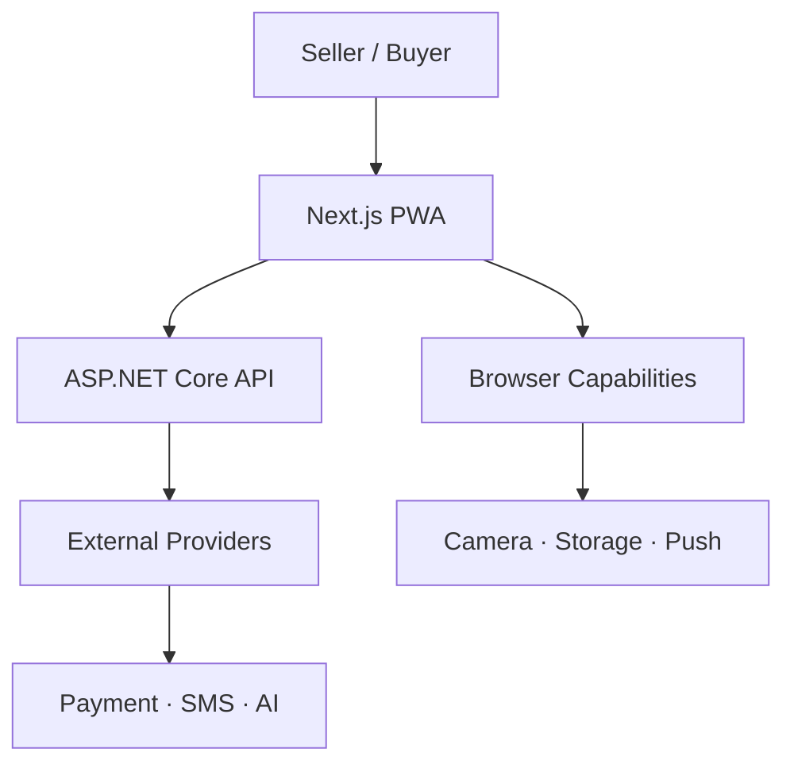
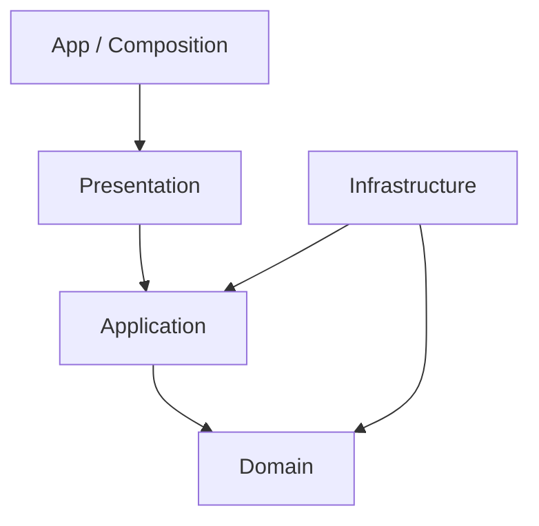
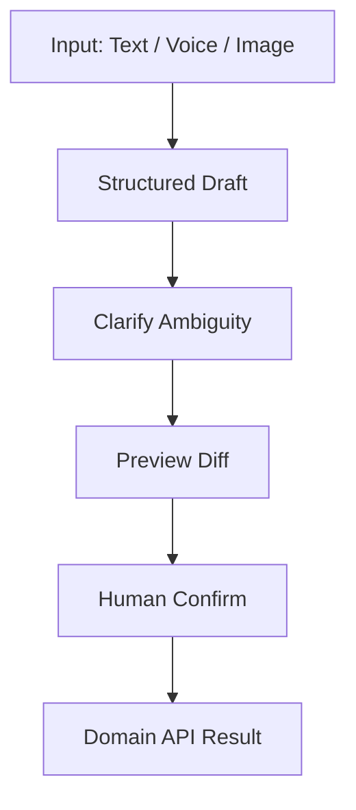
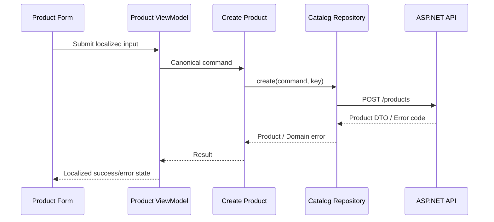

# معماری فرانت‌اند — وضعیت و اثرهای محصول

## اعتبارسنجی موبایل و ورودی عددی — بازنگری 2.4.1، 2026-09-26

ورود همچنان فقط با موبایل و OTP است؛ شاهکار و کد ملی به آن اضافه نمی‌شود. قواعد این بخش برای فرم‌های ورود فروشنده و مشتری در موبایل/دسکتاپ یکسان است.

| ورودی | قرارداد قطعی |
|---|---|
| موبایل ایران | مقدار نهایی رشته‌ای ۱۱ رقمی، با شروع `09`؛ پس از نرمال‌سازی ارقام، الگوی `^09[0-9]{9}$` |
| OTP | رشته دقیقاً ۶ رقمی با الگوی `^[0-9]{6}$`؛ صفر ابتدای `012345` حفظ شود |
| عدد صحیح | فقط رقم؛ min/max و مثبت‌بودن بسته به فیلد؛ موبایل و OTP به Number تبدیل نشوند |
| مقدار اعشاری / پول | قرارداد مستقل Decimal/Money؛ قانون عدد صحیح نباید فروش کیلویی و مقدار کسری را از کار بیندازد |

اعداد فارسی `۰۱۲۳۴۵۶۷۸۹` و عربی `٠١٢٣٤٥٦٧٨٩` به `0123456789` نرمال شوند. تایپ، Paste، autofill و ورودی موبایل همه از همان تابع کنترل عبور کنند؛ محدودسازی keydown به‌تنهایی کافی نیست. حروف، علامت منفی/مثبت، اعشار، نماد علمی مانند `1e5` و متن مختلط به‌عنوان عدد پذیرفته نشوند؛ حروف را حذف نکنید تا یک ورودی غلط به شماره یا کد دیگری تبدیل شود. انتخاب متن، پاک‌کردن، کلیدهای حرکت، Tab و میانبرهای Paste مجازند.

در فیلد موبایل، Paste یک شماره کامل با پیش‌شماره ایران `+98` یا `0098` و فاصله/خط تیره متعارف، قبل از اعتبارسنجی به فرم `09…` تبدیل شود؛ سایر کدهای کشور رد شوند. مقدار UI و payload این فلو در قالب محلی `09…` و با ارقام ASCII به API می‌رود. ورودی بلند بی‌صدا کوتاه نشود. در OTP فقط trim فضای ابتدا/انتها مجاز است؛ متن مخلوط، جداکننده داخلی و بیشتر از ۶ رقم رد شوند. SMS autofill کد استخراج‌شده را تحویل همین validator بدهد.

### زمان و اثر خطا

- فرم دست‌نخورده خطای قرمز ندارد. از اولین تغییر، اعتبارسنجی فرانت در همان رویداد input/change انجام شود؛ منتظر submit، blur یا پاسخ سرور نماند. شماره یا کد ناقصِ ویرایش‌شده هم نامعتبر است.
- هنگام اصلاح به مقدار معتبر، خطای قالب فوراً پاک شود. دکمه «دریافت کد ورود» فقط با موبایل معتبر و دکمه «تأیید و ورود» فقط با کد ۶ رقمی معتبر فعال شود. اعتبار قالب OTP به معنی درست‌بودن کد نیست؛ تطبیق کد و انقضا در سرور است.
- مقدار نامعتبر هیچ درخواست ارسال/تأیید OTP نسازد. خطای قالب از شکست سرویس پیامک یا کد نادرست سرور تفکیک شود. تلاش برای درج کاراکتر غیرعددی رد و پیام «فقط رقم وارد کنید» نمایش داده شود؛ مقدار پذیرفته‌شده قبلی حفظ شود و با ویرایش معتبر بعدی خطا پاک گردد.
- سرور همین قالب را مستقل دوباره اعتبارسنجی کند؛ فرانت جایگزین اعتبارسنجی API و محدودیت تلاش نیست.

### متن و ظاهر خطا

| حالت | پیام |
|---|---|
| موبایل خالی بعد از ویرایش | شماره موبایل را وارد کنید. |
| موبایل با طول/پیش‌شماره غلط | شماره موبایل باید ۱۱ رقم باشد و با ۰۹ شروع شود. |
| کاراکتر غیرعددی | فقط رقم وارد کنید. |
| OTP ناقص | کد ورود باید دقیقاً ۶ رقم باشد. |
| OTP صحیح از نظر قالب ولی ردشده سرور | کد واردشده درست نیست. دوباره تلاش کنید. |

خطای فیلد: حاشیه قرمز و متن Danger در کنار همان فیلد. خطای فرم/سرویس: `Alert / Type=Danger` با زمینه قرمز روشن، متن/حاشیه قرمز و آیکون هشدار. استفاده از رنگ سبز، Success یا رنگ برند برای قاب خطای اعتبارسنجی ممنوع است؛ رنگ برند روی دکمه «اصلاح» مجاز و معنای موفقیت ندارد. رنگ به‌تنهایی پیام خطا نیست. در فرانت `aria-invalid` و ارتباط خطا با `aria-describedby` و اعلان مناسب خوانشگر لحاظ شود؛ از اعلان مکرر و آزاردهنده هر رقم جلوگیری شود.

### کامپوننت‌های مشترک

در صفحه `03 — Product Entry Components` خانواده `Numeric Field` با `Kind=MobileIR | OTP | Integer` و `State=Empty | Filled | Focused | Error | Disabled` ساخته شد: ۱۵ واریانت. API نمایشی آن `Label`، `Value` و `Message` است؛ مثال‌های هر نوع در کنار خانواده آمده‌اند. ورودی‌های ورود و حالات خطای آن‌ها از instance این خانواده استفاده می‌کنند.

نگاشت پیاده‌سازی پیشنهادی: `IranMobileField`، `OtpField` و `IntegerField` روی یک زیرساخت مشترک DigitInput. موبایل `type="tel"`، `inputMode="numeric"`، `autoComplete="tel-national"`؛ OTP `type="text"`، `inputMode="numeric"`، `autoComplete="one-time-code"` و محدودیت منطقی ۶ رقم. `inputMode` فقط پیشنهاد صفحه‌کلید است، نه validator. از `type="number"` برای موبایل/OTP استفاده نشود. برچسب فارسی RTL و مقدار عددی در ناحیه LTR مستقل قرار گیرد. کنترل Paste شماره بین‌المللی قبل از محدودکردن طول انجام شود تا `+98` نیمه‌کاره بریده نشود.

صفحه‌های جدید نمونه حالت‌اند؛ فیگما کد اعتبارسنجی JavaScript یا ارسال پیامک واقعی اجرا نمی‌کند. رفتار لحظه‌ای تایپ باید طبق همین قرارداد در فرانت پیاده‌سازی شود.

### معیار پذیرش و مثال‌های ضروری

| ورودی / عمل | نتیجه |
|---|---|
| `09123456789`، `۰۹۱۲۳۴۵۶۷۸۹`، `٠٩١٢٣٤٥٦٧٨٩` | معتبر؛ خروجی واحد `09123456789` |
| Paste `+98 912 345 6789` یا `00989123456789` | تبدیل به `09123456789` و سپس اعتبارسنجی |
| `08123456789`، ۱۰ رقم، ۱۲ رقم، شماره ثابت | خطای فوری؛ بدون درخواست شبکه |
| Paste `0912abc456789` یا کشور دیگر | رد؛ بدون حذف حروف یا کوتاه‌کردن و تبدیل به شماره دیگر |
| OTP `012345` و `۰۱۲۳۴۵` | قالب معتبر؛ صفر اول حفظ شود؛ درستی کد با سرور |
| OTP `123`، `1234567`، `12a345`، `1e5`، `-12345` | نامعتبر؛ بدون درخواست تأیید |
| اصلاح شماره `08…` به `09…` با طول صحیح | پاک‌شدن فوری خطا و فعال‌شدن ارسال |
| فرم خالی دست‌نخورده | بدون پیام قرمز؛ اقدام اصلی غیرفعال |
| خطای قالب یا رد کد توسط سرور | Field Error / Alert Danger؛ بدون قاب سبز یا Success |
| مقدار کالای وزنی `1.5` | در DecimalQuantityField طبق قرارداد مقدار کسری مجاز؛ IntegerField جایگزین آن نشود |


---


## تصمیم جاری ورود — بازنگری 2.4.0، 2026-09-26

طبق آخرین اصلاح مالک محصول، ورود فقط با **شماره موبایل و کد یک‌بارمصرف پیامکی** است. درخواست پیشین درباره شاهکار لغو شد: در ورود هیچ کد ملی، استعلام شاهکار یا حالت عدم تطابق مالکیت شماره وجود ندارد. کد ملی اختیاری در اطلاعات مالک فروشگاه، اگر در پروفایل حفظ شده باشد، شرط ورود نیست.

OTP فقط دسترسی به شماره را تأیید می‌کند؛ اثبات مالکیت قانونی سیم‌کارت، اعتبار مالی یا مالکیت اسناد قدیمی نیست. ثبت مشتری توسط فروشنده بدون ورود مشتری و بدون OTP باقی می‌ماند. پنل مشتری در نسخه 1.2 از همین قرارداد استفاده می‌کند؛ زمان انتشار آن به MVP منتقل نمی‌شود.

| صفحه / حالت | داده و اقدام |
|---|---|
| auth / login | فقط موبایل؛ دریافت کد ورود؛ توضیح ارسال پیامک و شرایط استفاده |
| otp | کد؛ شماره مقصد؛ تأیید و ورود؛ اصلاح شماره؛ ارسال دوباره بعد از شمارنده سرور |
| otp-wrong | کد درست نیست؛ اصلاح کد؛ نشست صادر نشود |
| otp-expired | مهلت کد تمام شد؛ دریافت کد جدید |
| otp-limited | زمان انتظار؛ دکمه ارسال/تأیید محدودشده تا اجازه سرور غیرفعال |
| otp-send-failed | ارسال انجام نشد؛ تلاش دوباره یا اصلاح شماره |

در صفحه‌های محصول توضیح معماری، عبارت شاهکار، کد ملی ورود و دکمه نمایشی «کد نامعتبر یا منقضی» نباشد. خطا از نتیجه سرور نمایش داده می‌شود و گزینه انتخابی کاربر نیست. بدون صفحه انتخاب روش ورود، ایمیل یا رمز. نوار منوی فروشگاه در صفحه پیش از ورود نمایش داده نشود. استفاده از کامپوننت‌های صفحه 03 و فونت IRANSansX الزامی است.

API هویت متعلق به ASP.NET Core است. فرانت به سرویس پیامک مستقیم متصل نمی‌شود. نتیجه کدها با errorCode ترجمه و timestamp سرور نمایش داده می‌شود. Draft فروش بعد از ورود مجدد بازیابی می‌شود؛ داده حساس OTP در localStorage ذخیره نشود.

---


> بازنگری اسناد: 2.1.0 — 2026-09-24. شمارهٔ سند با شمارهٔ انتشار محصول متفاوت است. مبنا: ZIP اصلی، بازبینی‌های قبلی و تصمیم‌های اخیر مالک محصول. این بسته مشخصات پیشنهادی تکمیل‌شده برای بازبینی است؛ ادعای تغییر یا تأیید فیگما ندارد.

## وضعیت

طبق دستور مالک، بازطراحی معماری در این تحویل انجام نشده است. سند کامل قبلی در بخش مرجع حفظ شده؛ موارد محصولی جدید برای بازبینی بعدی آمده‌اند. قرارداد نسخه‌های محصول و واژگان جاری بر ارجاع‌های تاریخی مقدم است.

## اثرهای محصول برای بازبینی بعدی معماری

این بخش نیازمندی است، نه انتخاب تازه فناوری یا بازطراحی کدبیس:

- هویت کاتالوگ از کالای فروشگاه و موجودی جدا؛ واحد پایه و ضریب تاریخی هر ردیف.
- Catalog approval و override محلی مستقل؛ بارکد دارای scope و واحد؛ snapshot اسناد.
- رسید و فروش چندقلمی، پیش‌نویس و شناسه عملیات؛ کنترل اتمیک موجودی/فاکتور/دریافت/بدهی.
- دریافت و تخصیص به چند سند از ابتدا تفکیک مفهومی دارند؛ مشتری فروشگاهی با هویت تأییدشده و عضویت باشگاه یکی نیست.
- تاریخ رخداد، تاریخ ثبت، actor و علت اصلاح؛ وضعیت بهای معلوم/تخمینی/نامعلوم؛ نسخه گزارش و بازسازی وابستگی بها.
- داده تولید/انقضا/قیمت تولیدکننده/چاپی در ردیف ورود، نه محصول عمومی.
- SMS بعد از commit و قابل retry مستقل؛ ارسال/تحویل/ناموفق سه وضعیت متمایز.
- آینده: سفارش با نسخه، رزرو، دریافت بیعانه، تحویل؛ هزینه با تاریخ تعلق و پرداخت؛ چک با رویداد؛ سند حسابداری با مرجع و دوره.
- UI فروش جست‌وجو و سبد همزمان؛ ایجاد درجا و بازگشت به context؛ منوی موجودی مستقل؛ فیلتر گزارش پایدار.
- کنترل دسترسی فروشگاه در API، خروج امن، جداسازی cache، فایل خصوصی فیش/فاکتور و عدم افشای اطلاعات میان فروشگاه‌ها.

پیش از پیاده‌سازی، ADRهای فناوری، تعداد اپ‌ها، قرارداد پول، migration، نگاشت حساب و sync مرور می‌شوند. متن زیر وضعیت تاریخی معماری است و «پذیرفته‌شده» داخل آن به تاریخ همان متن برمی‌گردد؛ در این بازنگری دوباره تأیید نشده است. دامنه نسخه از roadmap جاری گرفته می‌شود.


## متن مرجع معماری قبلی — نیازمند بازبینی، غیرحاکم بر دامنه انتشار

# معماری کلان فرانت‌اند دکانی

> شناسه سند: `DOK-FEA-001`  
> نسخه سند: `1.1.0`  
> وضعیت: مبنای معماری برای پیاده‌سازی  
> تاریخ آخرین به‌روزرسانی: `2026-09-19`  
> مالک سند: Frontend Tech Lead  
> تأییدکننده: Product Owner  
> دامنه: معماری کلان Web/PWA، مرز لایه‌ها، ماژول‌ها، وابستگی‌ها و نیازمندی‌های کیفی  
> اسناد مرجع: `product-overview.md`، `product-roadmap.md`، `epics-and-user-stories.md`، `sprint-tasks.md`، `ui-guidelines.md`، `ux-guidelines.md`

---

## 1. هدف سند

این سند معماری کلان فرانت‌اند دکانی را تعریف می‌کند تا:

- نسخه اولیه سریع و قابل تحویل باشد.
- محصول با رشد قابلیت‌ها به کد یکپارچه و شکننده تبدیل نشود.
- UI، State، API client و سرویس‌های بیرونی قابل تعویض بمانند.
- فارسی و انگلیسی از روز اول و RTL/LTR به‌صورت واقعی پشتیبانی شوند.
- Seller، Buyer و Public Catalog در آینده بتوانند مستقل رشد کنند.
- مسیر احتمالی Microfrontend بدون تحمیل پیچیدگی آن در MVP باز بماند.
- عملیات مالی، موجودی و Agent با کنترل انسانی و داده قطعی نمایش داده شوند.

این سند درباره معماری بک‌اند، دیتابیس و DevOps فقط در حد قرارداد با فرانت صحبت می‌کند؛ جزئیات آن‌ها در اسناد مستقل می‌آیند.

---

## 2. وضعیت تصمیم‌ها

| تصمیم | وضعیت | بازبینی بعدی |
|---|---|---|
| Next.js App Router و TypeScript | پذیرفته‌شده | فقط با مانع فنی اثبات‌شده |
| PWA موبایل‌محور | پذیرفته‌شده | پس از پایلوت `v0.11` |
| Modular Clean Frontend | پذیرفته‌شده | پس از دو ماژول واقعی |
| Monorepo سبک | پذیرفته‌شده | با تشکیل چند تیم |
| ASP.NET Core تنها مرجع Business Rule | پذیرفته‌شده | ثابت |
| Tailwind محدود به UI Layer | پذیرفته‌شده | با ورود Designer |
| Design Token مبتنی بر CSS Variable | پذیرفته‌شده | هنگام Brand refresh |
| TanStack Query پشت Facade | پذیرفته‌شده | پس از اندازه‌گیری پیچیدگی Cache |
| بدون Global Store در Foundation | پذیرفته‌شده | هنگام ساخت POS |
| `next-intl` پشت i18n Facade | پذیرفته‌شده | قبل از افزودن زبان سوم |
| فارسی + انگلیسی از Foundation | پذیرفته‌شده | ثابت |
| Locale prefix صریح در URL | پذیرفته‌شده | پیش از Public launch |
| بدون Module Federation در MVP | پذیرفته‌شده | هنگام تشکیل تیم‌های deploy مستقل |
| فروش نهایی فقط Online | پذیرفته‌شده | پس از طراحی Offline Sync مستقل |

هر تغییر تصمیم پذیرفته‌شده باید با ADR جدید، اثر مهاجرت، هزینه و Release هدف ثبت شود.

---

## 3. محرک‌های معماری

### 3.1 محرک‌های محصول

- استفاده اصلی با موبایل و اغلب با یک دست
- سرعت بسیار بالای ثبت کالا، خرید و فروش
- فرم‌ها و جدول‌های پویا برای صنف‌های مختلف
- اسکن دوربین، بارکد، عکس، فایل و صدا
- گزارش، نمودار و Action Center
- دو سطح تجربه Seller و Buyer
- کاتالوگ عمومی و صفحات قابل اشتراک در آینده
- Agent کنترل‌شده برای عملیات تکی و گروهی
- رشد تدریجی از دو فروشگاه به شبکه فروشگاه‌ها

### 3.2 محرک‌های فنی

- Backend مستقل C# و قرارداد HTTP
- استقرار روی سرور خودمان و Container
- تعویض‌پذیری UI library، State library و Providerها
- اینترنت ناپایدار کاربران موبایل
- حساسیت عملیات مالی و موجودی
- فارسی، انگلیسی، RTL و LTR
- قابلیت تست خودکار و جلوگیری از Regression
- هزینه زیرساخت پایین در MVP

### 3.3 محدودیت‌های آگاهانه

- Microfrontend در MVP پیاده‌سازی نمی‌شود.
- Business Logic به Next.js Route Handler یا Server Action منتقل نمی‌شود.
- فروش/خرید قطعی در حالت Offline انجام نمی‌شود.
- UI Kit کامل از صفر و بدون Primitive دسترس‌پذیر ساخته نمی‌شود.
- Abstraction فقط روی نقاط تغییرپذیر یا پرریسک ایجاد می‌شود؛ React و DOM پشت Wrapper مصنوعی مخفی نمی‌شوند.

---

## 4. اصول معماری

### 4.1 Business First

ساختار کد بر اساس دامنه‌هایی مانند Catalog، Purchasing و Sales است، نه بر اساس پوشه عمومی `components` یا `hooks`.

### 4.2 Dependency Inversion در مرزهای متغیر

Feature به قرارداد داخلی دکانی وابسته است، نه مستقیم به Axios، Zustand، Barcode SDK، Chart library یا UI vendor.

### 4.3 Backend as Source of Truth

محاسبه نهایی قیمت، تخفیف مجاز، موجودی، سود، بدهی و مجوز در API اعتبارسنجی می‌شود. فرانت برای UX محاسبه خوش‌بینانه انجام می‌دهد، اما نتیجه سرور قطعی است.

### 4.4 Server State با Client State یکی نیست

داده API در Query cache نگه‌داری می‌شود؛ Store عمومی محل کپی موجودی، محصولات و فاکتورها نیست.

### 4.5 Progressive Enhancement

جریان اصلی با شرایط واقعی موبایل، دسترسی محدود دوربین و اینترنت ضعیف کار می‌کند. Barcode و Voice میان‌بُرند، نه تنها مسیر انجام کار.

### 4.6 Explicit State

Loading، Empty، Error، Offline، Permission denied، Conflict و Partial failure حالت‌های رسمی UI هستند.

### 4.7 Locale by Design

متن، جهت، تاریخ، عدد، پول، Validation و Route از ابتدا Locale-aware هستند. ترجمه یک عملیات Search/Replace انتهای پروژه نیست.

### 4.8 Measure Before Split

Package، Cache، Queue فرانت، Microfrontend یا بهینه‌سازی پیچیده فقط با نیاز و داده واقعی اضافه می‌شود.

---

## 5. نمای زمینه فرانت‌اند



قواعد مرز:

- Browser هیچ‌گاه مستقیم با بانک، AI model، SMS یا سرویس خصوصی تماس نمی‌گیرد.
- تمام Providerهای حساس پشت API بک‌اند قرار دارند.
- Service Worker اجازه نهایی‌کردن عملیات مالی را ندارد.
- API از طریق همان Origin و مسیر `/api` در Production در دسترس است.

---

## 6. فناوری‌های پایه

| حوزه | انتخاب مبنا | قانون استفاده |
|---|---|---|
| Framework | Next.js App Router | Routing و Composition؛ نه هسته Business |
| Language | TypeScript strict | `any` فقط با دلیل و مرز مشخص |
| UI styling | Tailwind + CSS Variables | فقط داخل UI/Design System |
| i18n | `next-intl` | فقط پشت `shared/i18n` |
| Server state | TanStack Query | فقط پشت Query/ViewModel API ماژول |
| Form | React Hook Form + Schema validation | پشت `shared/forms` یا Controller ماژول |
| API typing | OpenAPI generated types/client | فقط Infrastructure؛ فایل تولیدشده ویرایش نمی‌شود |
| Unit test | Vitest | Domain، Application و Utility |
| Component test | React Testing Library | رفتار کاربر، نه جزئیات پیاده‌سازی |
| API mock | MSW | تست و Storybook/Preview |
| E2E | Playwright | جریان‌های حیاتی و هر دو جهت |
| Package manager | pnpm workspace | Lockfile واحد و install قطعی |
| Lint/format | ESLint + Prettier | CI blocking |

نسخه دقیق Packageها هنگام Bootstrap روی نسخه Stable پین می‌شود و ارتقا فقط با Pull Request مستقل، Changelog و Regression انجام می‌شود.

---

## 7. ساختار Repository

```text
dokani/
├── apps/
│   ├── web/                         # Next.js PWA
│   └── api/                         # ASP.NET Core solution
├── packages/
│   ├── ui/                          # Design tokens + primitives
│   ├── eslint-config/               # dependency rules
│   ├── typescript-config/
│   └── test-utils/
├── docs/
│   ├── 00-product/
│   ├── 01-roadmap/
│   ├── 02-backlog/
│   ├── 03-frontend/
│   ├── 04-backend/
│   └── 05-devops/
├── infra/                           # compose/proxy/deploy config
├── tests/                           # cross-app E2E and fixtures
├── pnpm-workspace.yaml
└── README.md
```

قواعد:

- Turborepo/Nx در Sprint اول اجباری نیست.
- Workspace ساده تا زمانی که Build graph واقعی لازم نشده کافی است.
- Front و Backend یک Release repository دارند، ولی Pipeline می‌تواند با Path filter جدا اجرا شود.
- Secret، فایل محیط واقعی و داده مشتری وارد Repository نمی‌شوند.

---

## 8. ساختار برنامه Web

```text
apps/web/src/
├── app/                             # Next routes + composition roots
│   └── [locale]/
│       ├── (public)/
│       ├── (auth)/
│       ├── (seller)/
│       └── (buyer)/
├── modules/                         # business modules
├── shared/                          # reusable technical building blocks
├── infrastructure/                  # app-level adapters
├── i18n/                            # routing/request composition
├── config/                          # typed public configuration
└── styles/                          # root theme entry only
```

### 8.1 Route Groupها

| Route Group | مسئولیت |
|---|---|
| `(public)` | Landing، کاتالوگ عمومی، QR و صفحات قابل Share |
| `(auth)` | ورود Seller و OTP Buyer |
| `(seller)` | کالا، خرید، فروش، مشتری، نسیه و گزارش |
| `(buyer)` | فاکتورها، سفارش‌ها، پرداخت و باشگاه |

Route Group مرز UX است، نه Business Module. برای مثال ماژول Catalog می‌تواند هم در Seller و هم Public مصرف شود، ولی هر Surface ViewModel مخصوص خود را دارد.

### 8.2 نمونه Routeها

```text
/fa/login
/fa/seller/products
/fa/seller/sales/new
/fa/buyer/invoices
/fa/store/{storeSlug}

/en/login
/en/seller/products
/en/buyer/invoices
```

در MVP نام segmentهای فنی بین زبان‌ها ثابت می‌ماند؛ فقط Prefix زبان تغییر می‌کند. ترجمه کامل pathname فقط در صورت نیاز SEO واقعی بررسی می‌شود.

---

## 9. ساختار هر ماژول

```text
modules/catalog/
├── domain/
│   ├── product.ts
│   ├── product-rules.ts
│   └── catalog-errors.ts
├── application/
│   ├── ports/
│   ├── queries/
│   ├── commands/
│   └── view-models/
├── infrastructure/
│   ├── catalog-api.repository.ts
│   ├── catalog.dto.ts
│   └── catalog.mapper.ts
├── presentation/
│   ├── components/
│   ├── screens/
│   └── hooks/
├── i18n/
│   ├── fa.json
│   └── en.json
├── tests/
└── index.ts                         # تنها Public API ماژول
```

### 9.1 استفاده انتخابی از لایه‌ها

هر ماژول مجبور نیست پوشه خالی داشته باشد:

- ماژول دارای Rule مانند Sales، Inventory و Debt همه لایه‌ها را دارد.
- ماژول ساده تنظیمات ممکن است فقط Application، Infrastructure و Presentation داشته باشد.
- Rule خالص نباید صرفاً برای پرکردن Domain ساخته شود.

### 9.2 Public API

مصرف‌کننده فقط از `modules/catalog` import می‌کند:

```ts
import {ProductPicker, useProductSearch} from '@/modules/catalog';
```

Deep import ممنوع:

```ts
// ممنوع
import {mapProductDto} from '@/modules/catalog/infrastructure/catalog.mapper';
```

---

## 10. قانون وابستگی



قواعد قطعی:

1. Domain به React، Next.js، Query، API و Browser وابسته نیست.
2. Application قرارداد Repository/Service را تعریف می‌کند.
3. Infrastructure قرارداد Application را پیاده می‌کند.
4. Presentation فقط از Use Case، ViewModel و UI Kit استفاده می‌کند.
5. Composition Root در `app` پیاده‌سازی را به قرارداد متصل می‌کند.
6. `shared` به هیچ Feature Module وابسته نیست.
7. ماژول‌ها فقط از Public API یکدیگر استفاده می‌کنند.
8. وابستگی حلقوی در CI رد می‌شود.

Dependency Injection با Function factory، Provider محدود یا پارامتر انجام می‌شود؛ Container پیچیده DI در فرانت وارد نمی‌شود.

---

## 11. مرز App Router و Business Modules

`app` فقط این مسئولیت‌ها را دارد:

- Route و Layout
- Metadata
- Locale resolution
- Auth gate در سطح Navigation
- Provider composition
- Error/Loading boundary
- انتخاب Server یا Client rendering

`page.tsx` نباید Business Logic یا API mapping طولانی داشته باشد. الگو:

```tsx
export default function ProductsPage() {
  return <CatalogScreen />;
}
```

قواعد Server Action و Route Handler:

- Domain mutation اصلی از طریق ASP.NET Core API انجام می‌شود.
- Server Action جایگزین API فروش، خرید یا موجودی نیست.
- Route Handler فقط برای نیاز فنی Next، Proxy محدود یا Integration عمومی لازم استفاده می‌شود.
- Rule نباید بین Next server و C# دوباره‌سازی شود.

---

## 12. استراتژی Rendering

| Surface | استراتژی پیش‌فرض | دلیل |
|---|---|---|
| Landing/Public Store | Server-first | SEO، Share و First paint |
| Public Product | Server-first + client island | SEO و تعامل محدود |
| Seller Dashboard | Client-interactive | فرم، اسکن و Query تعاملی |
| POS | Client screen | سرعت و State موقت سبد |
| Reports | Server shell + client charts | First paint و فیلتر تعاملی |
| Buyer invoice | Server gate + client actions | امنیت و تعامل پرداخت |

اصول:

- `'use client'` در کوچک‌ترین مرز لازم قرار می‌گیرد.
- Domain و Mapperها مستقل از Server/Client هستند.
- Hydration فقط وقتی ارزش واقعی دارد اضافه می‌شود.
- داده خصوصی داخل Static generation یا Cache عمومی قرار نمی‌گیرد.
- Cache public و private سیاست جدا دارند.

---

## 13. معماری Design System

مرجع الزام‌های بصری، Token، Component، Responsive و Accessibility سند `ui-guidelines.md` است. مرجع Journey، Stateهای رفتاری، Microcopy و Acceptance تجربه سند `ux-guidelines.md` است. این فصل نحوه اعمال آن قراردادها در معماری فرانت‌اند را مشخص می‌کند و نباید تعریف موازی یا متناقض بسازد.

### 13.1 لایه‌ها

```text
Design Tokens
    ↓
UI Primitives
    ↓
UI Patterns
    ↓
Feature Components
    ↓
Screens
```

### 13.2 Design Tokens

Tokenها Semantic هستند:

```css
:root {
  --color-bg-canvas: ...;
  --color-bg-surface: ...;
  --color-text-primary: ...;
  --color-action-primary: ...;
  --radius-control: ...;
  --space-control-inline: ...;
  --font-body: ...;
}
```

Feature نباید از رنگ خام مانند `blue-500` به‌عنوان مفهوم Business استفاده کند.

### 13.3 UI Primitiveها

نمونه:

- `Button`
- `TextField`
- `NumberField`
- `MoneyField`
- `DateField`
- `Select`
- `Dialog`
- `Drawer`
- `Toast`
- `Table`
- `Stack`
- `Inline`
- `Grid`
- `Text`
- `Surface`

### 13.4 UI Patternها

- `EntityPicker`
- `SearchField`
- `BarcodeInput`
- `MoneySummary`
- `EmptyState`
- `ErrorState`
- `OfflineBanner`
- `ConfirmOperation`
- `DataListPage`
- `MobileActionBar`

### 13.5 قانون Third-party UI

برای Dialog، Menu، Focus trap و Accessibility از Primitive معتبر می‌توان استفاده کرد، اما import آن فقط داخل `packages/ui` مجاز است. بازنویسی ناقص کنترل‌های دسترس‌پذیر به اسم استقلال ممنوع است.

---

## 14. معماری چندزبانه و Locale

چندزبانه‌بودن بخشی از Foundation است و از Sprint 1 فعال می‌شود.

### 14.1 Localeهای اولیه

| URL Locale | Culture | جهت | وضعیت |
|---|---|---|---|
| `fa` | `fa-IR` | RTL | زبان پیش‌فرض و کامل |
| `en` | `en-US` | LTR | زبان دوم و کامل |

افزودن `ar` یا زبان دیگر فقط با افزودن Resource، تنظیمات Format و QA همان زبان انجام می‌شود؛ هیچ Feature نباید فرض کند فقط `fa` و `en` وجود دارند.

### 14.2 Locale Resolution

ترتیب انتخاب:

1. Locale صریح URL
2. ترجیح ذخیره‌شده کاربر واردشده
3. Cookie کاربر ناشناس
4. `Accept-Language` مرورگر
5. `fa` به‌عنوان Default

Root `/` به Locale مناسب Redirect می‌شود. Locale معتبر باید از Allowlist بیاید؛ مقدار دلخواه کاربر مستقیماً import یا اجرا نمی‌شود.

### 14.3 قرارداد URL

تمام Routeهای کاربری Prefix دارند:

```text
/{locale}/...
```

دلایل:

- لینک قابل Share زبان مشخص دارد.
- SSR و Metadata نتیجه قطعی دارند.
- Cache و SEO مبهم نمی‌شوند.
- تغییر زبان Route معادل را حفظ می‌کند.

### 14.4 Facade ترجمه

Featureها به API داخلی وابسته‌اند:

```ts
// Client Component
const t = useI18n('catalog.productForm');

// Server Component
const t = await getI18n('catalog.productForm');
```

فقط `shared/i18n` می‌تواند مستقیم از `next-intl` import کند. این Facade مسئول موارد زیر است:

- ترجمه متن
- Interpolation
- Pluralization
- تاریخ و زمان
- عدد و درصد
- پول
- List formatting
- Direction و locale metadata

### 14.5 Resourceها

ترجمه کنار ماژول نگه‌داری می‌شود:

```text
modules/catalog/i18n/fa.json
modules/catalog/i18n/en.json
modules/sales/i18n/fa.json
modules/sales/i18n/en.json
shared/i18n/messages/common.fa.json
shared/i18n/messages/common.en.json
```

در Build، Resourceهای هر Locale به‌صورت کنترل‌شده ترکیب و اعتبارسنجی می‌شوند.

### 14.6 قانون Translation Key

کلید باید Semantic و پایدار باشد:

```json
{
  "catalog.productForm.title.label": "عنوان کالا",
  "catalog.productForm.save.success": "کالا ذخیره شد"
}
```

کل جمله انگلیسی به‌عنوان Key استفاده نمی‌شود. Key تغییر UI copy را به تغییر Code تبدیل نمی‌کند.

### 14.7 ممنوعیت متن Hard-coded

متن کاربرمحور داخل JSX ممنوع است، به‌جز:

- داده واردشده توسط کاربر
- نام برند/محصول از API
- شناسه فنی در صفحه مخصوص توسعه
- Fixture تست

CI باید Missing key را Fail کند و Hard-coded text مشکوک را گزارش دهد.

### 14.8 جهت RTL/LTR

در Layout:

```tsx
<html lang={locale} dir={direction}>
```

قواعد CSS:

- استفاده از Logical properties مانند `margin-inline-start`
- ممنوعیت فرض دائمی `left/right` برای فاصله و Position
- آیکون Directional با `dir` Mirror می‌شود.
- آیکون‌های خنثی مانند Search یا Camera Mirror نمی‌شوند.
- جدول، نمودار، Drag & Drop و Swipe در هر دو جهت تست می‌شوند.
- ترتیب عدد، واحد و ارز فقط با Flex reversal حل نمی‌شود؛ Formatter مسئول است.

### 14.9 تاریخ و زمان

قواعد ذخیره و انتقال:

- Instantها در API با ISO 8601 و UTC منتقل می‌شوند.
- تاریخ بدون زمان مانند سررسید با نوع Date-only منتقل می‌شود.
- تقویم ذخیره‌سازی مستقل از نمایش است.
- `fa` به‌صورت پیش‌فرض تقویم فارسی نمایش می‌دهد.
- `en` تقویم Gregorian نمایش می‌دهد.
- Date picker پشت `DateField` قرار دارد و خروجی استاندارد تولید می‌کند.
- تبدیل Jalali/Gregorian داخل Feature انجام نمی‌شود.

### 14.10 عدد و رقم

- نمایش با `Intl.NumberFormat` یا Facade انجام می‌شود.
- ورودی ارقام فارسی، عربی و لاتین را می‌پذیرد.
- در Form boundary همه رقم‌ها به نمایش canonical لاتین نرمال می‌شوند.
- جداکننده هزارگان ورودی قبل از Validation حذف می‌شود.
- پارس عدد با `replace` پراکنده داخل Feature ممنوع است.

### 14.11 پول و ریال/تومان

قواعد:

- واحد ذخیره قطعی Backend از ابتدا مشخص و `IRR` است.
- DTO مبلغ را Integer string منتقل می‌کند تا Precision از دست نرود.
- UI می‌تواند بر اساس تنظیم فروشگاه تومان نمایش دهد.
- هر Field و Summary واحد نمایش را صریح نشان می‌دهد.
- تبدیل تومان/ریال فقط در `MoneyAdapter` انجام می‌شود.
- محاسبه مالی قطعی در Backend است.
- Locale جهت و Format را عوض می‌کند، نه ارزش مبلغ را.

نوع مفهومی:

```ts
type Money = Readonly<{
  amountRial: bigint;
  currency: 'IRR';
}>;
```

JSON مقدار `bigint` ارسال نمی‌کند؛ Infrastructure آن را از/به string نگاشت می‌کند.

### 14.12 خطاهای قابل ترجمه API

Backend به‌جای وابسته‌کردن UI به متن فارسی، کد پایدار و پارامتر می‌دهد:

```json
{
  "code": "inventory.insufficient",
  "params": {
    "available": 2,
    "requested": 4
  },
  "traceId": "..."
}
```

Frontend:

- `code` را به Translation key نگاشت می‌کند.
- `params` را Format و Interpolate می‌کند.
- Unknown code پیام عمومی به‌همراه `traceId` نشان می‌دهد.
- متن Server برای Debug نگه‌داری می‌شود، نه نمایش قطعی به کاربر.

### 14.13 محتوای واردشده توسط کاربر

- عنوان محصول فروشگاه خودکار ترجمه نمی‌شود.
- نام واردشده همان‌طور که کاربر ثبت کرده نمایش داده می‌شود.
- کاتالوگ عمومی آینده می‌تواند `LocalizedText` داشته باشد.
- ترجمه AI بدون تأیید به‌عنوان داده رسمی ذخیره نمی‌شود.
- Search باید حداقل نرمال‌سازی فارسی/عربی را مستقل از Locale UI انجام دهد.

### 14.14 تست چندزبانه

برای هر Feature:

- تست Missing key در `fa` و `en`
- Component test حداقل در Locale پیش‌فرض
- Smoke test انگلیسی/LTR
- E2E مسیر حیاتی در هر دو جهت
- Visual regression صفحات کلیدی RTL/LTR
- تست Text expansion حداقل ۳۰٪
- تست تاریخ، مبلغ، درصد و Validation
- تست تغییر زبان بدون از‌دست‌دادن مسیر و Draft

Pseudo-locale داخلی می‌تواند برای کشف بریدگی متن و Hard-code استفاده شود، ولی زبان قابل انتخاب کاربر نیست.

---

## 15. معماری API Client

### 15.1 جریان وابستگی

```text
Screen
→ ViewModel Hook
→ Query/Command
→ Repository Port
→ API Repository
→ Generated Client
→ ASP.NET Core
```

### 15.2 Generated Client

- OpenAPI منبع تولید Type/Client است.
- خروجی داخل `shared/api/generated` یا Infrastructure ماژول قرار می‌گیرد.
- فایل Generated دستی ویرایش نمی‌شود.
- تغییر Breaking قرارداد در CI تشخیص داده می‌شود.
- Generated DTO در Presentation import نمی‌شود.

### 15.3 Mapper

Mapper مرز DTO و مدل فرانت است:

```ts
function toProduct(dto: ProductDto): Product {
  return {
    id: ProductId(dto.businessId),
    title: dto.title,
    salePrice: moneyFromApi(dto.salePriceRial),
    status: mapProductStatus(dto.status)
  };
}
```

مزیت:

- نام فیلد API به UI نشت نمی‌کند.
- Date/Money/Enum یکجا نرمال می‌شوند.
- تغییر Client generator اثر محدود دارد.

### 15.4 Request Context

API adapter خودکار اضافه می‌کند:

- Correlation ID در صورت نیاز
- Locale/`Accept-Language`
- نسخه Client
- Credential همان Origin
- Idempotency key برای Commandهای حساس

Token داخل `localStorage` نگه‌داری نمی‌شود.

---

## 16. Server State

TanStack Query پیاده‌سازی انتخاب‌شده است، اما Feature API داخلی خود را ارائه می‌دهد:

```ts
const products = useProductList(filters);
const createProduct = useCreateProduct();
```

ممنوع:

```tsx
// داخل Screen ممنوع
useQuery({queryKey: ['products'], queryFn: () => axios.get(...)})
```

### 16.1 Query Key Factory

هر ماژول Factory دارد:

```ts
const catalogKeys = {
  all: ['catalog'] as const,
  lists: () => [...catalogKeys.all, 'list'] as const,
  list: (filter: ProductFilter) => [...catalogKeys.lists(), stableFilter(filter)] as const,
  detail: (id: ProductId) => [...catalogKeys.all, 'detail', id] as const
};
```

### 16.2 Cache Policy

- موجودی و قیمت فروش Stale time کوتاه دارند.
- داده مرجع مانند Category می‌تواند Cache طولانی‌تر داشته باشد.
- داده خصوصی Persist عمومی نمی‌شود.
- Invalidation بر اساس Use Case تعریف می‌شود، نه `invalidateQueries()` گسترده.
- Optimistic update در موجودی/پرداخت فقط با طراحی Rollback و پاسخ قطعی مجاز است.
- Locale فقط وقتی بخشی از Query key است که پاسخ API واقعاً localized باشد.

---

## 17. Client State و Workflow State

### 17.1 ترتیب انتخاب ابزار

1. State داخل Component
2. State بالا‌برده‌شده در Feature
3. `useReducer` برای Workflow محلی
4. URL state برای Filter/Sort/Page قابل Share
5. Store اختصاصی Feature فقط با نیاز اثبات‌شده

Global Store پیش‌فرض وجود ندارد.

### 17.2 Store Facade

اگر POS به Store نیاز داشت:

```ts
const {
  items,
  total,
  addByBarcode,
  changeQuantity,
  createDraft,
  clear
} = useSaleCart();
```

فقط پیاده‌سازی `useSaleCart` می‌تواند Zustand، State machine یا راهکار دیگر را مصرف کند. Component selector کتابخانه بیرونی را import نمی‌کند.

### 17.3 قواعد State

- Server entity در Store کپی نمی‌شود مگر Snapshot لازم برای Draft.
- Derived state ذخیره نمی‌شود؛ محاسبه می‌شود.
- State مالی با پاسخ Server reconcile می‌شود.
- Persist فقط از طریق Storage Port انجام می‌شود.
- Version schema برای Draft persisted ضروری است.

---

## 18. معماری فرم

### 18.1 لایه‌ها

- Schema اولیه برای Feedback سریع
- Form Controller برای تبدیل input به Command
- Backend validation برای Rule قطعی
- Error mapper برای Field و Form error

### 18.2 قواعد

- Form Component مستقیماً DTO API نمی‌سازد.
- Number/Money/Date parser متمرکز است.
- Validation message با Code ترجمه می‌شود.
- فیلدهای صنفی از Attribute Schema رندر می‌شوند.
- Draft مهم در قطع کوتاه اینترنت قابل بازیابی است.
- Submit دوتایی با pending state و idempotency کنترل می‌شود.
- Focus اولین خطا روی موبایل مدیریت می‌شود.

### 18.3 فرم پویا

Attribute renderer بر اساس نوع:

```text
text → TextField
number → NumberField
money → MoneyField
date → DateField
select → Select
multi-select → MultiSelect
boolean → Switch
```

Registry داخل Forms adapter است؛ Feature شرط‌های طولانی برای نوع Field نمی‌نویسد.

---

## 19. احراز هویت و مجوز

### 19.1 MVP

- ASP.NET Core مدیریت هویت و Session را انجام می‌دهد.
- Cookie امن، `HttpOnly` و SameSite مناسب استفاده می‌شود.
- Web و API پشت یک Origin قرار می‌گیرند.
- Mutationها CSRF protection دارند.
- Logout نشست Server را باطل می‌کند.
- Client فقط خلاصه Session و Permission را دریافت می‌کند.

### 19.2 Authorization

- UI برای تجربه بهتر Action غیرمجاز را مخفی/غیرفعال می‌کند.
- API همیشه مجوز را دوباره بررسی می‌کند.
- Route guard جایگزین API authorization نیست.
- Permission stringها Typed و متمرکزند.
- Owner/Staff از روز اول مدل جدا دارند، حتی اگر یک نفر باشند.

### 19.3 مسیر آینده

Auth Port اجازه می‌دهد OTP Buyer و بعداً OIDC/Bank identity بدون بازنویسی Featureها اضافه شوند.

---

## 20. PWA و Offline Resilience

### 20.1 قابلیت نسخه اولیه

- Manifest و Add to Home Screen
- آیکون و Splash مناسب
- Cache فایل‌های Static versioned
- تشخیص Online/Offline
- حفظ Draft فرم‌های منتخب
- Retry آگاهانه Query امن
- Update notification برای Service Worker

### 20.2 مواردی که Offline قطعی نمی‌شوند

- Finalize فروش
- Finalize خرید
- ثبت پرداخت
- تغییر موجودی
- مصرف امتیاز
- ثبت سفارش قطعی

در حالت Offline، UI می‌تواند Draft بسازد ولی دکمه نهایی وضعیت Online را مطالبه می‌کند.

### 20.3 Storage Port

```ts
interface DraftStorage<T> {
  load(key: string): Promise<VersionedDraft<T> | null>;
  save(key: string, value: VersionedDraft<T>): Promise<void>;
  remove(key: string): Promise<void>;
}
```

پیاده‌سازی اولیه می‌تواند IndexedDB باشد. Feature به API مرورگر وابسته نیست.

### 20.4 امنیت Offline

- Token در Draft ذخیره نمی‌شود.
- PII و داده مالی حداقل نگه‌داری می‌شوند.
- Logout Draft حساس را مطابق Policy پاک می‌کند.
- Cache پاسخ خصوصی با Cache عمومی مخلوط نمی‌شود.

---

## 21. Barcode، Camera و File

### 21.1 Barcode Port

```ts
interface BarcodeScanner {
  isSupported(): boolean;
  requestPermission(): Promise<PermissionResult>;
  scan(options: ScanOptions): Promise<BarcodeScanResult>;
  stop(): Promise<void>;
}
```

قواعد:

- SDK یا Browser API فقط Adapter است.
- ورود دستی بارکد همیشه وجود دارد.
- Permission denied و Camera unavailable حالت رسمی‌اند.
- Scan فقط کد می‌خواند؛ تطبیق Product با API انجام می‌شود.
- اسکن تکراری در POS مطابق تنظیم +1 یا ورود تعداد عمل می‌کند.

### 21.2 File Upload Port

- Type/size قبل از Upload بررسی می‌شود.
- اعتبارسنجی Server قطعی است.
- Progress، cancel و retry پشتیبانی می‌شوند.
- Image compression کیفیت OCR را خراب نمی‌کند.
- Upload receipt فقط Draft خرید می‌سازد.
- URL موقت و مجوز دسترسی مدیریت می‌شوند.

---

## 22. Agent، Voice و OCR در فرانت

تمام قابلیت‌های AI از الگوی زیر تبعیت می‌کنند:



قواعد:

- Browser مستقیم Model provider را فراخوانی نمی‌کند.
- Streaming فقط تجربه را بهتر می‌کند و مجوز ایجاد نمی‌کند.
- Confidence پایین با سؤال یا حالت بررسی نشان داده می‌شود.
- Diff قبل/بعد برای عملیات تغییر نمایش داده می‌شود.
- Command نهایی Idempotency key دارد.
- UI موفقیت را فقط پس از پاسخ Domain API نشان می‌دهد.
- ترجمه ورودی/خروجی Agent از Locale UI مستقل از زبان گفتار مدل می‌شود.

---

## 23. معماری گزارش و نمودار

- Backend Read Model اعداد قطعی را تولید می‌کند.
- Front فقط Presentation aggregation محدود انجام می‌دهد.
- Chart library پشت `shared/charts` قرار دارد.
- هر نمودار Summary متنی و جدول داده دارد.
- RTL/LTR، اعداد، Tooltip و Axis تست می‌شوند.
- رنگ تنها حامل معنا نیست.
- Drill-down از کارت به سند مبدأ حفظ می‌شود.
- Filterهای گزارش در URL قرار می‌گیرند تا Refresh و Share کنترل‌شده باشند.

---

## 24. Microfrontend Readiness

### 24.1 اکنون

یک Next.js App و یک Deployment داریم. Module Federation نصب نمی‌شود.

### 24.2 آمادگی معماری

- Route ownership روشن برای Seller/Buyer/Public
- Module Public API
- Design System Package
- قرارداد API versioned
- نبود Singleton business store مشترک
- Event/Navigation contract محدود
- استقلال ترجمه هر ماژول
- تست Architecture boundary

### 24.3 Trigger واقعی جداسازی

Microfrontend فقط وقتی بررسی می‌شود که حداقل یکی برقرار باشد:

- دو یا چند تیم مستقل نیازمند Deploy مستقل باشند.
- Release cadence Seller و Buyer مانع یکدیگر شود.
- Bundle/ownership با lazy loading و module boundary حل نشود.
- محدودیت امنیتی یا سازمانی Deployment جدا بخواهد.

### 24.4 گزینه‌های آینده

ترتیب ارزیابی:

1. Route-level code splitting در همان App
2. استخراج Packageهای مستقل در Monorepo
3. Next.js Multi-Zones برای Appهای مستقل زیر یک Domain
4. Module Federation فقط با Spike و معیار موفقیت روشن

هیچ Feature امروز نباید به API خاص Module Federation وابسته شود.

---

## 25. Error Handling

### 25.1 طبقه‌بندی

| نوع | نمونه | رفتار UI |
|---|---|---|
| Validation | مقدار نامعتبر | کنار Field |
| Business Rule | موجودی ناکافی | پیام قابل اقدام |
| Authentication | نشست منقضی | حفظ Draft و ورود مجدد |
| Authorization | مجوز ناکافی | صفحه/Action مناسب |
| Conflict | قیمت یا نسخه تغییر کرده | Refresh و مقایسه |
| Network | قطع/Timeout | Offline/Retry state |
| Unexpected | خطای ناشناخته | پیام عمومی + Trace ID |

### 25.2 Error Boundary

- Root boundary برای Crash عمومی
- Route boundary برای هر Surface
- Feature boundary برای Widgetهای مستقل
- Query error داخل State همان Feature
- Error boundary نباید خطای Business را به Crash تبدیل کند.

### 25.3 Retry

- GET امن Retry محدود دارد.
- Command مالی بدون Idempotency خودکار Retry نمی‌شود.
- وضعیت Timeout با «نامشخص» از «ناموفق» جداست.
- Retry button همان Command ID را مطابق Contract استفاده می‌کند.

---

## 26. Observability فرانت

Eventهای فنی:

- App loaded
- Route error
- API latency/error category
- Web Vital
- Service Worker update/failure
- Barcode permission/failure
- Upload/OCR job state
- Agent command accepted/rejected

Eventهای محصول:

- Onboarding step
- Product create started/completed
- Barcode local/global/unknown/conflict
- Purchase finalized
- Sale finalized
- Report opened/action taken

قواعد:

- شماره موبایل، متن Voice، تصویر فاکتور و نام مشتری داخل Analytics عمومی ارسال نمی‌شوند.
- Event schema version دارد.
- Locale، app version و anonymized store cohort در صورت مجازبودن ثبت می‌شوند.
- Trace ID API برای پشتیبانی قابل کپی است.

---

## 27. Security Frontend

- عدم نگه‌داری Credential در `localStorage`
- CSP و محدودیت Sourceهای Script/Image/Connect
- Escape پیش‌فرض React و ممنوعیت HTML خام بدون Sanitization
- کنترل Upload type/size در Client و Server
- Mask داده حساس در Log و Error report
- Dependency review و Lockfile قطعی
- عدم اعتماد به Role/Store ID ارسالی UI
- Same-origin API و CSRF protection
- Timeout/Lock مناسب صفحات حساس روی دستگاه مشترک
- Feature Flag امنیت را دور نمی‌زند.
- Source map Production عمومی نمی‌شود؛ در سامانه خطا به‌صورت امن Upload می‌شود.

---

## 28. Performance Budget

بودجه دقیق پس از Baseline Sprint 1 ثبت می‌شود؛ قواعد اولیه:

- Routeهای عمومی کمترین JavaScript لازم را ارسال می‌کنند.
- Chart، Scanner، Excel parser و AI UI lazy load می‌شوند.
- تصویر resize و format مناسب دارد.
- جدول بزرگ Virtualization را فقط پس از عبور از Threshold فعال می‌کند.
- Search input debounce و request cancellation دارد.
- Query key و selectorها پایدارند.
- Provider بزرگ روی کل App بی‌دلیل قرار نمی‌گیرد.
- ترجمه فقط namespaceهای لازم Route را Load می‌کند.
- Bundle analyzer در Releaseهای اصلی اجرا می‌شود.

KPIهای هدف پس از اندازه‌گیری:

- Core Web Vitals صفحات عمومی
- زمان بازشدن POS
- زمان اولین نتیجه Search
- زمان Scan تا افزودن به سبد
- زمان تعامل پس از Navigation
- حجم JS هر Route group

---

## 29. Accessibility و Mobile UX

- حداقل اندازه Touch target در Design System رعایت می‌شود.
- Focus visible و Keyboard navigation وجود دارد.
- Dialog focus trap و return focus دارد.
- Label و Error field با ARIA متصل‌اند.
- رنگ تنها نشانه موفق/خطا نیست.
- نمودار Summary متنی دارد.
- Camera/Voice مسیر جایگزین دستی دارند.
- reduced motion رعایت می‌شود.
- Zoom و font scaling شکسته نمی‌شوند.
- Screen reader در RTL/LTR Smoke test می‌شود.
- Action اصلی در محدوده مناسب استفاده یک‌دستی قرار می‌گیرد.

---

## 30. Testing Strategy

### 30.1 هرم تست

| سطح | موضوع |
|---|---|
| Unit | Rule، Mapper، Formatter، Reducer |
| Component | رفتار فرم، Stateها، RTL/LTR |
| Integration | Repository + Mock API + Query |
| Contract | OpenAPI و Error codes |
| E2E | جریان کامل کاربر |
| Visual | Design System و صفحات حیاتی |

### 30.2 E2E حیاتی تا `v1.0`

1. ورود و جداسازی فروشگاه
2. ثبت عنوان-only کالا
3. Barcode محلی/سراسری/ناشناخته
4. Import Excel و ردیف خطا
5. خرید و افزایش موجودی
6. فروش و کاهش موجودی
7. پرداخت ترکیبی
8. گزارش و Drill-down
9. نسیه و تسویه جزئی
10. Agent Draft/Confirm/Cancel

### 30.3 Matrix محیط

- موبایل Android Chrome به‌عنوان هدف اصلی
- iOS Safari/PWA Smoke
- Desktop Chrome/Edge
- عرض باریک، متوسط و دسکتاپ
- `fa`/RTL و `en`/LTR
- Online، slow network و قطع کوتاه

---

## 31. Quality Gateهای CI

Pull Request بدون عبور از موارد زیر Merge نمی‌شود:

- TypeScript strict check
- ESLint و Import boundary
- Format check
- Unit/Component tests
- Translation key parity برای `fa` و `en`
- Missing translation check
- OpenAPI client generation clean diff
- Build همه Localeها
- Secret scan
- Dependency vulnerability policy
- Migration/Backend checks در Pipeline مربوط

روی Release Candidate:

- Playwright critical suite
- Accessibility scan
- Bundle budget
- PWA manifest/service worker smoke
- Visual RTL/LTR صفحات کلیدی

---

## 32. قرارداد ViewModel

Presentation ترجیحاً مدل آماده نمایش دریافت می‌کند:

```ts
type ProductListItemViewModel = Readonly<{
  id: string;
  title: string;
  priceText: string;
  stockText: string;
  stockTone: 'normal' | 'warning' | 'critical';
  canEdit: boolean;
}>;
```

مزایا:

- Component از Money/Date/API format بی‌خبر است.
- Locale change در ViewModel/Formatter مدیریت می‌شود.
- Permission و tone یکجا تعیین می‌شوند.
- UI library تعویض‌پذیرتر می‌ماند.

اما ViewModel نباید Rule مالی جدید بسازد؛ فقط مدل دامنه قطعی را آماده نمایش می‌کند.

---

## 33. نمونه Vertical Slice ثبت کالا



مراحل:

1. `ProductForm` فقط input و state نمایشی را مدیریت می‌کند.
2. Parser عدد و پول ورودی را canonical می‌کند.
3. Command مستقل از زبان UI ساخته می‌شود.
4. Use Case Ruleهای فرانت و Idempotency را اعمال می‌کند.
5. Repository DTO را ارسال و پاسخ را Map می‌کند.
6. Backend Rule قطعی را اجرا می‌کند.
7. Error code به متن Locale جاری تبدیل می‌شود.
8. Queryهای لازم دقیق invalidate می‌شوند.

---

## 34. Map ماژول‌های فرانت

| ماژول | مسئولیت | آغاز نسخه |
|---|---|---:|
| `auth` | Session، login، permission view | `v0.2` |
| `catalog` | Product، Variant، category، brand | `v0.3` |
| `barcode` | Scan UI و lookup state | `v0.4` |
| `imports` | Grid، Excel، mapping و preview | `v0.5` |
| `pricing` | Rule، history و suggestion UI | `v0.5` |
| `purchasing` | Purchase draft/finalize/history | `v0.6` |
| `inventory` | Balance، movement، adjustment | `v0.6` |
| `sales` | POS، cart، invoice | `v0.7` |
| `customers` | Customer profile و history | `v0.7` |
| `payments` | Method، split payment و status | `v0.7` |
| `reports` | Dashboard، chart و drill-down | `v0.8` |
| `actions` | Alert، suggestion و goal | `v0.8` |
| `agent` | command، ambiguity، preview، audit | `v0.9` |
| `debt` | credit ledger و settlement | `v0.12` |
| `buyer` | OTP، invoices و profile | `v1.1` |
| `voice` | recording و voice draft | `v1.1` |
| `ocr` | upload، job و review | `v1.2` |
| `loyalty` | point/reward wallet | `v1.4` |
| `orders` | buyer cart، order و reservation | `v1.6` |
| `maps` | nearby stores و service area | `v1.8` |

هر ماژول قبل از شروع، سند مستقل لایه‌ها، Public API و dependencyهای خود را خواهد داشت؛ این سند جای آن جزئیات را نمی‌گیرد.

---

## 35. برنامه پیاده‌سازی معماری

### Sprint 1

- Monorepo و Web app
- TypeScript strict
- Route groups پایه
- `[locale]` segment با `fa` و `en`
- `shared/i18n` facade
- `html lang/dir`
- PWA manifest اولیه
- API error base contract
- Test skeleton
- ESLint boundaries baseline

### Sprint 2

- Auth adapter و session provider
- Same-origin credential flow
- Localized auth errors
- Permission API اولیه
- RTL/LTR login test

### Sprint 3

- Tokenها و UI primitives
- CSS logical properties
- UI third-party facade
- Query، Form، Notification adapter
- Module template و Public API rule
- Storybook/Preview در صورت توجیه ظرفیت
- Visual smoke دو جهت

### Sprint 4 به بعد

هر Feature به‌صورت Vertical Slice ساخته می‌شود؛ لایه‌های افقی بدون مصرف‌کننده واقعی به‌صورت گسترده از قبل ساخته نمی‌شوند.

---

## 36. Definition of Done فرانت

Feature زمانی Done است که:

- از مرز ماژول و Public API تبعیت کند.
- Business Rule در Component قرار نگرفته باشد.
- مستقیم به API/UI/State vendor وابسته نباشد مگر در Adapter مجاز.
- Loading/Empty/Error/Offline/Success را پوشش دهد.
- `fa` و `en` ترجمه کامل داشته باشند.
- RTL و LTR تست شده باشند.
- عدد، تاریخ و پول از Formatter داخلی استفاده کنند.
- Mobile viewport پذیرفته شده باشد.
- Accessibility پایه پاس باشد.
- Unit/Component test لازم موجود باشد.
- Event و Error telemetry بدون PII اضافه شده باشد.
- Story acceptance در محیط هدف Demo شده باشد.

---

## 37. Anti-patternهای ممنوع

- پوشه عمومی بزرگ `components` برای همه Featureها
- import مستقیم Axios/Fetch در Component
- import مستقیم Zustand/Redux در Screen
- import مستقیم UI vendor در Feature
- Tailwind classهای Design System داخل Feature Screen
- ذخیره Query data در Global Store
- Business Rule داخل JSX یا `useEffect`
- `useEffect` برای مشتق‌کردن State قابل محاسبه
- مبلغ با `number` اعشاری و محاسبه float
- متن فارسی/انگلیسی Hard-coded در JSX
- تبدیل پراکنده ارقام و تاریخ
- نمایش مستقیم Message دلخواه Server
- نگه‌داری Token در Local Storage
- Catch خالی یا Toast عمومی بدون State قابل بازیابی
- barrel export بی‌قاعده که dependency cycle پنهان کند
- Shared utility حاوی Rule یک Feature
- Module Federation پیش از وجود نیاز سازمانی

---

## 38. ریسک‌ها و کنترل‌ها

| ریسک | کنترل |
|---|---|
| معماری بیش از حد برای MVP | Vertical Slice و لایه انتخابی |
| Wrapperهای بی‌ارزش | فقط مرز Vendor/Browser/API |
| نشت Tailwind | ESLint/Review و UI package |
| ترجمه ناقص | parity check و Missing key CI |
| شکستن LTR | visual/E2E دو جهت |
| اشتباه ریال/تومان | Money type و unit صریح |
| اختلاف تقویم | storage استاندارد و Date adapter |
| Query cache قدیمی موجودی | policy کوتاه، invalidation و Server validation |
| Draft قدیمی | schema version و migration/discard policy |
| Duplicate command | idempotency key |
| رشد `shared` به سطل عمومی | ownership و dependency rule |
| وابستگی به Next internals | Domain/Application framework-free |
| هزینه Microfrontend آینده | route/module ownership از ابتدا |

---

## 39. ADRهای لازم در زمان پیاده‌سازی

این تصمیم‌های جزئی هنگام Bootstrap با Spike کوتاه ثبت می‌شوند:

1. انتخاب Primitive دسترس‌پذیر UI پشت Facade
2. انتخاب OpenAPI Type/Client generator
3. Strategy دقیق Service Worker و Update
4. IndexedDB adapter برای Draft
5. Barcode scanner adapter و Browser matrix
6. Chart library پشت `shared/charts`
7. Date picker با پشتیبانی تقویم فارسی
8. Error monitoring provider

معیار انتخاب هر مورد:

- Accessibility
- TypeScript quality
- Bundle cost
- SSR/App Router compatibility
- نگه‌داری و Community health
- License
- امکان Wrapper واقعی
- تست‌پذیری

---

## 40. منابع فنی مبنا

- Next.js App Router: <https://nextjs.org/docs/app>
- Next.js PWA guide: <https://nextjs.org/docs/app/guides/progressive-web-apps>
- Next.js internationalization: <https://nextjs.org/docs/app/guides/internationalization>
- Next.js Multi-Zones: <https://nextjs.org/docs/app/guides/multi-zones>
- `next-intl` App Router: <https://next-intl.dev/docs/getting-started/app-router>
- `next-intl` locale routing: <https://next-intl.dev/docs/routing/setup>
- TanStack Query overview: <https://tanstack.com/query/latest/docs/framework/react/overview>
- Tailwind Theme Variables: <https://tailwindcss.com/docs/theme>
- MDN `Intl.DateTimeFormat`: <https://developer.mozilla.org/docs/Web/JavaScript/Reference/Global_Objects/Intl/DateTimeFormat>

نسخه مستندات هنگام پیاده‌سازی دوباره بررسی می‌شود و کد بر اساس API نسخه پین‌شده نوشته خواهد شد.

---

## 41. معیار بازبینی معماری

معماری در این نقاط بازبینی می‌شود:

- پس از Sprint 3: ارزیابی هزینه واقعی boundaryها
- پس از ساخت Catalog و Purchasing: ارزیابی Template ماژول
- پس از POS: تصمیم Store و Performance
- پس از پایلوت `v0.11`: ارزیابی PWA/Offline/UX
- پیش از Buyer app `v1.1`: ارزیابی Surface split
- پیش از شبکه `v1.8`: ارزیابی Public performance و Scale
- هنگام تشکیل تیم دوم: ارزیابی Package/App extraction

بازبینی به معنی بازنویسی پیش‌فرض نیست؛ هر تغییر باید مسئله اندازه‌گیری‌شده را حل کند.

---

## 42. تاریخچه تغییرات

## 43. مرزبندی اپ‌ها و دامنه‌ها

| App | Host | مسئولیت |
|---|---|---|
| Landing | `2kni.ir` | معرفی، SEO و هدایت به اپ‌ها |
| Shop | `shop.2kni.ir` | فروشگاه، کاتالوگ، موجودی، فروش، سفارش، مشتری، نسیه و گزارش |
| Customer | `customer.2kni.ir` | OTP، خریدها، فاکتورها، سفارش، پرداخت، تسویه و اعتبار |
| Admin | `admin.2kni.ir` | انواع فروشگاه، taxonomy، کاتالوگ، پیشنهاد اصلاح، ادغام و Seed |
| API | `api.2kni.ir` | BFF/API مشترک و قراردادهای نسخه‌شده |

پیشنهاد اجرایی تا پیش از نیاز واقعی به Micro Frontend، Monorepo با Appهای مستقل و Packageهای مشترک است:

- `apps/landing`
- `apps/shop`
- `apps/customer`
- `apps/admin`
- `packages/ui`
- `packages/design-tokens`
- `packages/domain-contracts`
- `packages/api-client`
- `packages/i18n`

هر App ترکیب route و feature مخصوص خود را دارد؛ Domain logic در کامپوننت نهایی قرار نمی‌گیرد. قراردادهای کاتالوگ، موجودی، سفارش، پرداخت، تسویه و اعتبار در لایه application/domain از UI، Zustand/Redux و کتابخانه‌های شبکه مستقل می‌مانند.

احراز هویت می‌تواند سرویس مشترک داشته باشد، اما Session فروشنده، مشتری و ادمین باید Audience/Role جدا و Cookieهای محدود به دامنه مناسب داشته باشد. لینک فاکتور مشتری به `customer.2kni.ir` هدایت می‌شود و API اجازه افشای فاکتورهای سایر شماره‌ها را نمی‌دهد.


| نسخه | تاریخ | تغییر |
|---|---|---|
| `1.0.0` | `2026-09-18` | ایجاد معماری کلان Next.js PWA، Modular Clean Frontend، UI/State/API facade، آمادگی Microfrontend و پشتیبانی فارسی/انگلیسی از Foundation |
| `1.1.0` | `2026-09-19` | اتصال رسمی معماری فرانت‌اند به UI Guidelines و UX Guidelines به‌عنوان مراجع Design System و رفتار تجربه |

## 44. تصمیم نهایی تجربه‌های موبایل و دسکتاپ — `v2.0.0`

شش تجربه محصول با چهار App پیاده می‌شوند:

```text
apps/
  landing/
  admin/
  customer/   # Mobile + Desktop
  seller/     # Mobile + Desktop
packages/
  design-tokens/ ui/ icons/ auth/ api-client/
  domain/ validation/ localization/ config/ observability/ testing/
```

- `seller` و `customer` در سطح دامنه، API client و componentهای پایه مشترک‌اند؛ صفحه و composition می‌تواند برای viewport متفاوت باشد.
- موبایل از Bottom Navigation، card/list و CTA دسترس‌پذیر با یک دست استفاده می‌کند.
- دسکتاپ از Sidebar، table/grid، split view و فرم چندستونه استفاده می‌کند.
- CSS Variableهای `--dukani-*` از ۹۰ متغیر Figma تولید/همگام می‌شوند و themeهای `Shop Light`، `Customer Light` و `Admin Light` دارند.
- import مستقیم رنگ و spacing در Feature ممنوع است؛ semantic token مصرف می‌شود.

| نسخه | تاریخ | تغییر |
|---|---|---|
| `2.0.0` | `2026-09-23` | تثبیت چهار App/شش تجربه، responsive composition، themeهای معنایی و قرارداد ۹۰ Token |
